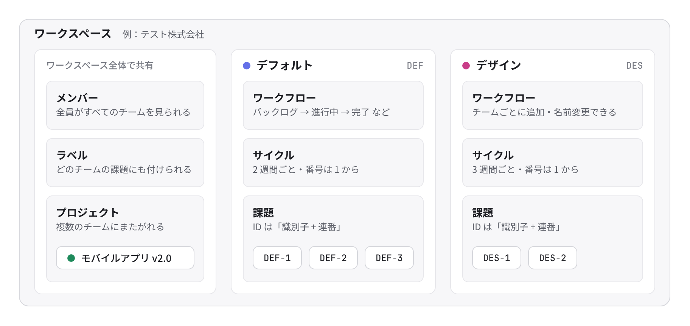
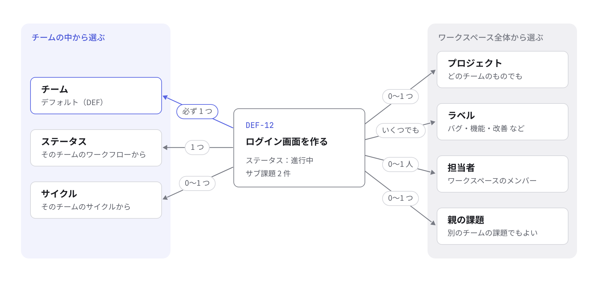
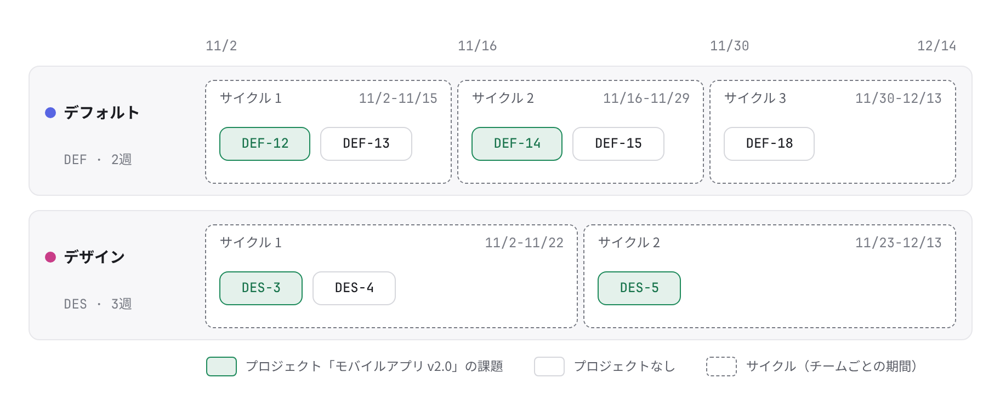
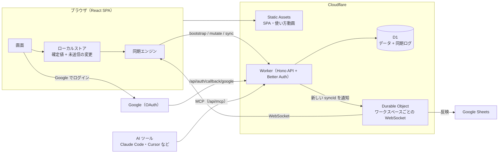

# Sen（線）— Linear の思想を受け継いだ日本語の課題管理アプリ

**速く、静かに、チームの仕事を前へ。**
Sen は [Linear](https://linear.app) の設計思想（待ち時間のない操作・キーボード中心・決まったワークフロー）を受け継いだ、日本語 UI の課題管理アプリです。Cloudflare Workers + D1 + Durable Objects の上で動き、**各画面の使い方動画を AI がヘッドレスブラウザで実際に操作して自動収録する仕組み**を備えています。

---

## 受け継いだ 3 つの原則

| 原則 | Sen での実装 |
| --- | --- |
| **速さ（待ち時間ゼロ）** | 起動時にワークスペース全体を手元に読み込み、画面はすべてローカルのデータから描画。変更は楽観的に即反映し、裏でサーバーへ送信します。次回からは IndexedDB のキャッシュで瞬時に起動し、差分だけを取得。サービスワーカーによりオフラインでも起動でき、オフライン中の変更は接続が戻ると自動で送信されます。 |
| **キーボードで完結** | `⌘K` コマンドパレット、`C` 作成、`J/K` 移動、`S/P/A/L` でプロパティ変更、`X` で複数選択、`G → I` などの移動、`⌘Z` で元に戻す。`?` で一覧表示。 |
| **決まった流れ** | バックログ → 未着手 → 進行中 → レビュー中 → 完了。チーム・プロジェクト・サイクルでリズムを作ります。 |

## 主な機能

- **課題**：チームごとの連番 ID（`ENG-12`）、ステータス・優先度・担当者・ラベル・プロジェクト・サイクル・見積もり・期日・親子関係
- **一覧**：リスト / ボード（ドラッグ＆ドロップ）、グループ分け（ステータス・担当者・優先度・プロジェクト・サイクル・ラベル）、並び順、フィルター、表示項目の切り替え（画面ごとに保存）
- **課題の詳細**：GitHub と同じ Markdown（GFM）のエディタ、サブ課題、変更履歴、コメント（`@` メンション）、購読（[詳しく](#本文の書き方markdown)）
- **課題どうしの関係**：「ブロックされている / ブロックしている」「関連」「重複」。未完了の課題に止められている課題には一覧・ボードで印が付き、重複にした課題は自動で「重複」ステータスへ（`M → B / X / R / M`）
- **受信トレイ**：割り当て・コメント・メンション・ステータス変更の通知を課題ごとにまとめて表示、キーボードで既読 / 削除
- **自分の課題**：担当・作成・購読中
- **プロジェクト**：ステータス・リード・目標日・進捗率・バーンアップチャート・お気に入り
- **サイクル**：現在 / 今後 / 過去、スコープと完了の推移グラフ、`Shift+C` で追加
- **検索**：タイトル・説明・ID を即時検索（ひらがな / カタカナ / 全角半角の違いを吸収）
- **リアルタイム同期**：Durable Object（WebSocket Hibernation）が変更を通知し、各クライアントが差分を取得
- **ローカルファースト**：IndexedDB キャッシュによる瞬時の起動、サービスワーカーによるオフライン起動、`⌘Z` で直前の操作を元に戻す
- **アプリとしてインストール（PWA）**：デスクトップやスマートフォンのホーム画面から専用のウィンドウで開けます。新しいバージョンを公開すると「更新」を案内します（[詳しく](#アプリとしてインストールpwa)）
- **AI 連携（MCP）**：Claude Code・Cursor・VS Code などの AI ツールから、課題の作成・更新・検索・コメント・関係づけ。AI の変更には「Claude Code 経由」の印（[詳しく](#ai-連携mcp)）
- **進捗**：ワークスペースのメンバーが、プロジェクト（活動）ごとの完了率・直近期限・活動状況と、作業の WBS・タイムラインをアプリの中で見られます。数え方はスプレッドシート連携と同じです（[詳しく](#進捗ページ)）
- **スプレッドシート連携**：プロジェクトを「活動」、課題を「タスク」として、Google スプレッドシートの「活動一覧」「WBS」に書き出します（[詳しく](#スプレッドシート連携)）
- **ログイン**：Google アカウントのみ（[Better Auth](https://www.better-auth.com)）。初めての人はログイン後にワークスペースを作るか、招待リンクから参加
- **設定**：プロフィール、テーマ（ライト / ダーク / システム）、メンバー招待リンク・権限、ラベル、チーム、ワークフロー、サイクル期間
- **使い方動画**：各画面右上の「▶ 使い方」とヘルプ画面から再生。チャプター（ステップ）クリックで頭出し、再生速度切り替え。収録シナリオは操作の結果を確かめながら撮るので、画面が壊れていれば収録が失敗します（`bun run tutorials:check` で古い動画も検出）

## 使い方：チーム・プロジェクト・サイクル・課題

Sen では、課題を **チーム** に入れて管理します。**プロジェクト** はチームをまたいで「何を作るか」で課題を集め、**サイクル** はチームの中で「いつやるか」を区切ります。図のチーム名・課題・日付は説明のための例です。

### 何が何の中にあるか

<picture>
  <source media="(prefers-color-scheme: dark)" srcset="docs/images/team-structure-dark.png">
  
</picture>

- チームが持つのは、ワークフロー（ステータスの並び）・サイクル・課題の 3 つです。
- メンバー・ラベル・プロジェクトはワークスペース全体で共有します。チームごとのメンバー登録はなく、ワークスペースの全員がすべてのチームを見て操作できます。
- 課題の ID は「チームの識別子 + 連番」です（`DEF-1`、`DES-1` など）。番号はチームごとに 1 から振られます。

### 1 つの課題から見たつながり

<picture>
  <source media="(prefers-color-scheme: dark)" srcset="docs/images/issue-links-dark.png">
  
</picture>

- 課題が必ず持つのはチームだけです。ステータスとサイクルは、そのチームのものからしか選べません。
- プロジェクト・ラベル・担当者・親の課題は、チームに関係なく選べます。
- 課題を別のチームへ移すと、ID が振り直され（`DEF-12` → `DES-6` など）、ステータスは移った先の同じ種類のものに置き換わり、サイクルは外れます。

### プロジェクトはチームをまたぎ、サイクルはチームの中で区切る

<picture>
  <source media="(prefers-color-scheme: dark)" srcset="docs/images/projects-and-cycles-dark.png">
  
</picture>

- 緑の課題は、プロジェクト「モバイルアプリ v2.0」の課題です。`DEF` と `DES` の両方にまたがり、プロジェクトの画面で進捗率とバーンアップチャートにまとめて集計されます。
- 点線の枠はサイクルです。期間はチームごとに 1〜4 週間から選べます（図では `DEF` が 2 週間、`DES` が 3 週間）。課題が入れるのは自分のチームのサイクルだけです。

| もの | 表すこと | ポイント |
| --- | --- | --- |
| チーム | 誰が受け持つか | 課題・ワークフロー・サイクルを持つ。識別子（`DEF`）が課題 ID の頭になる |
| プロジェクト | 何を作るか | 複数のチームの課題を集めて、進み具合を自動で集計する。リードや目標日を決められる |
| サイクル | いつやるか | チームごとの 1〜4 週間の区切り。課題を今のサイクル・次のサイクルに入れて進める |
| ラベル | どんな種類か | バグ・機能・改善など。全チーム共通で、1 つの課題にいくつでも付けられる |

### はじめの流れ

1. ワークスペースを作ると、最初のチーム「デフォルト」（識別子 `DEF`）とラベル（バグ・機能・改善）が作られます。名前と識別子は、設定の「チームの設定」から変えられます。初めて作るワークスペースには、使い方を学べるサンプルの課題・プロジェクト・サイクルも入ります。2 つ目以降のワークスペースには入りません。
2. 仕事を受け持つまとまりごとに、チームを追加します（[下記](#チームを追加する)）。
3. 作りたいものごとにプロジェクトを作ります。サイドバーの「プロジェクト」→「新しいプロジェクト」で、関わるチームを選びます。
4. チームの「サイクル」→「新しいサイクル」で、今の期間を作ります。
5. 課題を `C` で作り、`⇧P` でプロジェクトに、`⇧C` でサイクルに入れます。

### チームを追加する

1. 左上のワークスペース名のメニュー、または `G` → `S` で設定を開き、「ワークスペース」の「チーム」を選びます。
2. チーム名（例：デザイン）と識別子（例：`DES`）を入力します。識別子は英大文字で始まる 1〜7 文字の英数字で、課題 ID の頭に付きます。
3. 「チームを作成」を押します。作ったチームはサイドバーの「チーム」に並びます。

作ったチームには、7 つのステータス（バックログ・未着手・進行中・レビュー中・完了・キャンセル・重複）が最初から入り、課題の番号は `DES-1` から始まります。管理者でなくても、メンバーなら誰でも作れます。チームの設定では、ステータスの追加と名前の変更、サイクルを使うかどうかと期間（1〜4 週間）を変えられます。

## 本文の書き方（Markdown）

課題の説明、プロジェクトの説明、コメントは、GitHub 互換の Markdown（GFM）の文字列で保存します。サーバーは受け取った文字列を書き換えず、そのまま保存します。GitHub と同期したとき、変わっていないのに差分が出ないようにするためです。

エディタは Markdown を直接読み書きします。開いただけ、クリックしただけでは保存しません。

書ける記法と、エディタでの入れ方は次のとおりです。

| 記法 | 入れ方 |
| --- | --- |
| 見出し（h1〜h6） | `# ` から `###### ` |
| 箇条書き | `- ` |
| 番号付き | `1. ` |
| チェックリスト | `[] ` |
| コード | ```` ``` ```` で囲む |
| 引用 | `> ` |
| リンク | `[表示](https://…)` |
| 太字 | `**文字**` |
| 斜体 | `*文字*` |
| 取り消し線 | `~~文字~~` |
| 水平線 | `---` |
| 表 | \| 見出し1 \| 見出し2 \| と書いて Enter |
| 画像 | `` |
| 注記 | 引用（`> `）の最初の行に `[!NOTE]`・`[!TIP]`・`[!IMPORTANT]`・`[!WARNING]`・`[!CAUTION]` と書いてスペース |
| 脚注 | `[^1]` で参照する。段落の先頭に `[^1]: ` で定義する |

下線は Markdown に書き方が無いので、使えません。

- **表**：カーソルが表の中にあるとき、表の上に操作バーが出ます。行・列の追加と削除、列の寄せ、表の削除ができます。Tab で次のセルへ移ります。見出しの行は削除できません。
- **画像**：使えるのは http(s) の URL だけです。ファイルのアップロードや貼り付けはできません。画像は、見る人のブラウザが直接読み込みます。リファラーは送りません。
- **注記**：表示は、`[!NOTE]` が「メモ」、`[!TIP]` が「ヒント」、`[!IMPORTANT]` が「重要」、`[!WARNING]` が「警告」、`[!CAUTION]` が「注意」です。
- **脚注**：定義は、書いた場所に表示します。
- **改行**：GitHub の Issue やコメントと同じです。1 回の改行が、そのまま改行になります。
- **生の HTML**：`<details>`、`<!-- コメント -->`、`<br>`、`<kbd>` などは、元の文字列のまま保存します。HTML として表示も実行もせず、ソースとして見せます。「HTML」の印が付きます。
- **貼り付け**：文字だけを貼り付けると、Markdown として読み込みます。Web ページからのコピーは、今まで通りです。
- **上限**：GitHub に合わせます。課題のタイトルは 256 文字、説明とコメントは 65,536 文字までです。JS の文字数で数えるので、GitHub より厳しいか、同じです。
- **編集して保存したとき**：Sen のエディタで編集して保存すると、最初の 1 回だけ書き方が整えられます。表のセルの幅をそろえたり、改行に空白 2 個を付けたりします。GitHub での表示は同じです。2 回目以降は、変えたところ以外は変わりません。

## 構成



- **同期の仕組み**：すべての変更は `sync_log` に連番で記録されます。クライアントは「最後に受け取った番号」以降だけを取得します。Durable Object は「新しい変更がある」ことだけを通知するので、接続が切れても取りこぼしません。
- **楽観的更新**：画面の状態 =「サーバー確定値」+「未送信の変更」。他人の変更が届くたびに未送信の変更を重ね直すため、衝突しても表示が崩れません。失敗した変更は自動で巻き戻し、トーストで知らせます。
- **ログイン**：Better Auth の Google ログインだけを有効にしています。ログインの情報は `auth_*` テーブル、アプリのプロフィール（表示名・設定）は `users` テーブルが持ち、同じ ID で結び付けます。以前のメール + パスワードのアカウントは、同じメールアドレスの Google アカウントで初めてログインしたときに引き継がれます（ワークスペースや課題はそのまま）。
- **自動マイグレーション**：初回のリクエストでスキーマを作成します（`wrangler d1 migrations` と同じ管理テーブルを使うので併用できます）。`0006_markdown_bodies` は、保存済みの説明とコメントを、HTML から Markdown へ一度だけ移します。`wrangler d1 migrations apply` は SQL ファイルだけを流すので、この移行は新しい Worker が最初のリクエストで行います。未変換の行の一覧を表で持つので、複数の Worker が同時に動いても、途中で止まっても、二重に変換しません。文字として書かれていた `<` や `1.` などは、記法にならないようにエスケープします。`updated_at` は変えません。移行のあとは、開いていた画面に全体を読み込み直させ、ブラウザのキャッシュ（IndexedDB）も捨てます。
- **定期メンテナンス**：Cron Trigger（毎日 3:17 JST）で 30 日より古い同期ログと期限切れセッションを削除します。古いキャッシュを持つクライアントには全体の読み込み直しを指示します。

## アプリとしてインストール（PWA）

| 環境 | インストールの方法 |
| --- | --- |
| Chrome / Edge（デスクトップ・Android） | 設定 → プロフィールと表示 →「アプリをインストール」、ワークスペースのメニュー、`⌘K` の「アプリをインストール」、またはアドレスバーのインストールボタン |
| Safari（iPhone / iPad） | 共有ボタン →「ホーム画面に追加」 |
| Safari（Mac） | ファイル →「Dock に追加」 |

- **オフライン起動**：ビルド時に `vite.config.ts` が、遅れて読み込む画面（エディタ・ボード）やフォントまで含めたファイルの一覧をサービスワーカー（`src/sw.js` → `sw.js`）に埋め込みます。初めて開いたときにまとめて保存するので、一度開けばオフラインでもどの画面でも起動できます（使い方動画と API は保存しません）。画面の移動はネットワークを優先し、オフラインや 3 秒以上かかる回線では保存しておいた版で起動します。
- **更新**：新しいバージョンを公開すると、裏で保存してから「新しいバージョンがあります［更新］」と案内します。押すまでは今の版のまま動きます。押したときは、書きかけの説明文などの保存と送信が終わるのを待ってから切り替え、作成中の課題や書きかけのコメントがあれば捨ててよいか確かめます。画面の JS と CSS がすでに新しい版のものなら、案内は出しません。別のタブで古い画面が開いたままでも動くよう、1 つ前の版の保存内容は残します。
- **ショートカット**：インストールしたアプリのアイコンを右クリック（長押し）すると、「新しい課題を作成」「受信トレイ」「自分の課題」「検索」を直接開けます（`/?open=inbox` のような URL）。
- **見た目**：タイトルバーやステータスバーはテーマ（ライト / ダーク）の背景色に合わせ、ノッチのあるスマートフォンでは画面の切り欠きを避けて表示します。
- **アイコン**：`public/icons/` の PNG は `bun run icons` で `favicon.svg` と同じ図柄から書き出します（Android の maskable、iOS の `apple-touch-icon` を含む）。

## AI 連携（MCP）

Claude Code・Cursor・VS Code などの AI ツールから、Sen の課題を操作できます。

1. 設定 → AI 連携 を開きます。
2. 使う AI ツールを選び、できることと有効期限を決めて「接続用のトークンを発行」を押します。
3. 表示されたコマンドや設定を、その AI ツールに貼ります。
4. AI ツールを開き直し、「自分に割り当てられた課題を一覧にして」のように話しかけます。

| ツール | できること |
| --- | --- |
| `get_workspace` | チーム・ステータス・メンバー・ラベル・プロジェクト・今日の日付を取得する |
| `search_issues` | 課題を検索する |
| `get_issue` | 課題の説明・サブ課題・関係・コメントを取得する |
| `create_issues` | 課題をまとめて作成する（サブ課題を含む） |
| `update_issues` | 課題をまとめて更新する |
| `add_comment` | コメントを追加する |
| `link_issues` | 課題どうしを関係づける |

**仕組み**

- 接続先は `POST /api/mcp` です。MCP の Streamable HTTP で、セッションを持たないステートレスなサーバーです。
- トークンはワークスペースごと・個人ごとに発行します。保存するのはハッシュだけで、トークン自体は発行したときだけ表示します。
- 閲覧のみの権限と、有効期限（30日・90日・1年・無期限）を選べます。メンバーから外すと、その人のトークンは使えなくなります。
- 書き込みは画面と同じミューテーションを通るので、検証・履歴・通知・リアルタイム同期がそのまま効きます。履歴・コメント・通知には、どの AI ツールから行ったかが残ります（「Claude Code 経由」）。
- 説明とコメントは、GitHub 互換の Markdown（GFM）の文字列を、変換せずにそのまま受け渡します。課題のタイトルは 256 文字、説明とコメントは 65,536 文字までです（JS の文字数で数えるので、GitHub より厳しいか、同じです）。
- 課題の削除（アーカイブ）はできません。

手元で試すときは、`bun run dev` で起動し、発行したトークンで次を実行します。

```bash
claude mcp add --transport http sen http://localhost:5173/api/mcp --header "Authorization: Bearer sen_..."
```

## 進捗ページ

サイドバーの「進捗」から開きます。`G` → `R` でも、コマンドパレットの「進捗へ移動」でも開けます。

3 つのタブがあります。

- **活動一覧**は、プロジェクトごとの完了率・直近期限・活動状況です。上の数字は、活動の数、タスクの完了、期限超過、保留ありをまとめます。状況のボタンで、見たい活動だけに絞れます。
- **WBS**は、作業を担当・期限・状態つきで並べます。完了を隠したり、担当や工程で絞ったりできます。
- **タイムライン**は、着手日から完了予定までを横棒で見ます。縮尺は週・月・四半期です。

数え方はスプレッドシート連携と同じです（[集計のルール](#集計のルール)）。

着手日は、履歴から求めます。バックログや未着手に戻して今の着手時刻が消えても、初めて進行中になった日が残っていれば、その日を出します。

ほかの人が課題を更新すると、開いている進捗もその場で書き変わります。

スプレッドシート連携が有効なときは、右上に「スプレッドシートを開く」が出ます。

## スプレッドシート連携

Sen のプロジェクトを「活動」、課題を「タスク」として、Google スプレッドシートの「活動一覧」「WBS」に書き出します。アプリからシートへの一方向です。シートを直接編集しても、次の反映で上書きされます。同じ数字はアプリの「進捗」ページでも見られます。

保存すると、約 30 秒後に自動で反映します。設定画面の「今すぐ反映」でも、毎日の Cron（3:17 JST）でも反映します。Cron では、期限の超過など日付で変わる値を計算し直します。

### シートの中身

| タブ | 列 |
| --- | --- |
| 活動一覧 | 活動（プロジェクト名・リンク）、直近期限、完了率、活動状況 |
| WBS | 活動、工程、作業（課題 ID とタイトル・リンク）、説明、担当、着手日、完了予定、状態、完了日、優先度 |

どちらのタブも、最後の列は「ID（連携用）」です。この列は非表示です。ほかのタブには触れません。

活動一覧は、アーカイブしていないプロジェクトが 1 行ずつです。WBS は、下の対象になる課題が 1 行ずつです。WBS の行は、プロジェクトの表示順、完了予定が早い順（未設定は後ろ）、チームの識別子、番号の順です。

各タブの上には、ワークスペース名、最終反映の日時、「このシートは Sen から自動で作られます。変更は Sen で行ってください。」と出ます。

### 集計のルール

タスクに数える課題は、次を除いたものです。

- アーカイブした課題
- プロジェクトが付いていない課題
- ステータスの種類がキャンセルの課題。初期状態の「キャンセル」と「重複」は、どちらも種類がキャンセルです

プロジェクトをアーカイブすると課題からプロジェクトが外れるので、その課題もここから外れます。キャンセルと重複だけが残った活動は、タスクが無いときと同じ表示になります。

**完了率**は、対象のタスクが無いとき `タスクなし` です。あるときは、種類が完了の件数を対象の件数で割り、小数点以下を切り捨てます。`50%（1/2）` のように、割合と件数を書きます。保留は未完了として数えます。

**直近期限**は、保留でない未完了（未着手と進行中）だけを見ます。

- 対象が無い、すべて完了、または未完了がすべて保留のときは `—` です。
- 保留でない未完了に期限が無いときは `期限未設定` です。
- 期限があるときは、いちばん早い完了予定を `2026/11/04` の形で出します。期限の無いものが残っていれば、`2026/11/04（未設定2件）` のように足します。

**保留**は、ステータスの種類がバックログの課題です。表示名を変えても、種類がバックログなら保留です。

**活動状況**は、次の順で最初に当てはまったものです。今日は日本時間です。期限が今日のものは、期限超過にしません。保留の課題の期限は、期限超過の判定には使いません。種類が進行中なら、表示名が「レビュー中」でも進行中です。

| 順 | 条件 | 活動状況 |
| --- | --- | --- |
| 1 | 対象のタスクが無い | タスク未登録 |
| 2 | 未完了が無い | 完了 |
| 3 | 保留でない未完了に、期限が今日より前のものがある | 期限超過 |
| 4 | 未完了に保留がある | 保留あり |
| 5 | 未完了に進行中がある | 進行中 |
| 6 | 上のどれでもない | 未着手 |

**工程**は、`工程:` または `工程：` で始まるラベルです。接頭辞を除いた名前を、名前順に `／` でつなぎます。接頭辞のあとが空のラベルは使いません。

**着手日**は、その課題が初めて進行中（または完了）になった日です。日本時間の `2026/11/04` の形で出します。今の着手時刻、作成時の状態が進行中または完了だったときの作成の履歴、進行中または完了へ移した状態変更の履歴、状態を戻したときに消えた着手時刻（その状態変更の履歴に残したもの）のうち、いちばん早い時刻を使います。状態変更の履歴では、そこに記録した遷移先のステータスの種類を見ます。この仕組みを入れる前の履歴には種類が無いので、今のステータスから種類を判断します。バックログや未着手に戻すと今の着手時刻は消えますが、履歴が残っていればその日を出します。ステータスをあとから削除しても、履歴に種類が残っていれば着手日は残ります。

**状態**はステータスの表示名です。**完了日**は、種類が完了のときだけ、完了した日（日本時間）を出します。**優先度**は「なし」「緊急」「高」「中」「低」です。

### 使い方のおすすめ

チームの設定で「バックログ」を「保留」、「レビュー中」を「確認待ち」に名前を変えると、シートの「状態」にもその名前で出ます。

工程は、`工程:企画・設計` のようなラベルを作って、課題に付けます。

活動を終えるときは、プロジェクトをアーカイブせず、課題を完了にしてください。プロジェクトをアーカイブすると、課題からプロジェクトが外れ、シートから消えます。

### 設定のしかた

1. Google Cloud でプロジェクトを選び、Google Sheets API を有効にします。
2. サービスアカウントを作り、JSON の鍵を発行します。
3. 書き込み先のスプレッドシートを作り、サービスアカウントのメールアドレス（鍵の `client_email`）に「編集者」で共有します。報告を読む人には「閲覧者」で共有します。
4. Worker に登録します。`SHEETS_WORKSPACE` はワークスペースの URL の名前です（例：`ses`）。`SHEETS_SPREADSHEET_ID` は、スプレッドシートの URL の `/d/` と `/edit` の間です。

   ```bash
   bunx wrangler secret put SHEETS_WORKSPACE
   bunx wrangler secret put SHEETS_SPREADSHEET_ID
   bunx wrangler secret put GOOGLE_SERVICE_ACCOUNT_KEY < key.json
   ```

5. 設定 → ワークスペース の「スプレッドシート連携」で「今すぐ反映」を押します。最初の反映で「活動一覧」と「WBS」のタブが作られます。ほかのタブには触れません。

連携されるのは `SHEETS_WORKSPACE` のワークスペースだけです。それ以外では、設定画面にこの区画は出ません。

手元で試すときは、`.env.local` に同じ名前で書きます。鍵は 1 行の JSON にして、`'` で囲みます。

```bash
SHEETS_WORKSPACE=ses
SHEETS_SPREADSHEET_ID=xxxxxxxx
GOOGLE_SERVICE_ACCOUNT_KEY='{"type":"service_account","client_email":"...","private_key":"..."}'
```

| 変数 | 内容 |
| --- | --- |
| `SHEETS_WORKSPACE` | 連携するワークスペースの URL の名前（例：`ses`） |
| `SHEETS_SPREADSHEET_ID` | スプレッドシートの ID。URL の `/d/` と `/edit` の間 |
| `GOOGLE_SERVICE_ACCOUNT_KEY` | サービスアカウントの JSON 鍵 |
| `SHEETS_SYNC_DELAY_MS` | 保存から反映までの待ち時間（ミリ秒）。省略時は `30000` |
| `GOOGLE_API_ORIGIN_FOR_TESTS` | E2E 用。`DEV_TOOLS=1` のときだけ有効で、Google の代わりにこのオリジンへ送ります。本番では無視します |

### 仕組みと安全のために

- 鍵は Worker の secret にだけ置きます。シートにも、アプリの画面にも出しません。
- 書き込むのはサービスアカウントだけです。読む人の権限は、Google の共有設定のままです。
- 文字列は文字列として書くので、`=` で始まるタイトルが数式として動きません。
- 毎回、対象のタブ全体を置き換えるので、重複や消し残しが出ません。
- 保存のあとの自動反映が失敗したときは、2 分後、その次は 10 分後にやり直します。それ以上は入れません。「今すぐ反映」と毎日の Cron では、このやり直しは入れません。失敗の理由は設定画面に出ます。
- 403 のときは、共有していない場合と Google Sheets API が有効でない場合とで、設定画面の理由を出し分けます。
- 反映の予約と状態は、ワークスペースごとの Durable Object が持ちます。DB のテーブルは増えません。

## はじめかた（ローカル）

必要なもの：[Bun](https://bun.sh)（パッケージ管理）と Node.js 20 以上（Vite・Wrangler の実行に使います）。

```bash
bun install
bun run dev          # http://localhost:5173
```

ログインには Google の OAuth クライアントが必要です（初回だけ）。

1. [Google Cloud Console](https://console.cloud.google.com/apis/credentials) で「OAuth クライアント ID」（種類：ウェブ アプリケーション）を作成し、承認済みのリダイレクト URI に `http://localhost:5173/api/auth/callback/google` を追加します。
2. プロジェクト直下に `.env.local` を作り、クライアント ID とシークレットを書きます（Git には含まれません）。

   ```bash
   GOOGLE_CLIENT_ID=xxxxxxxx.apps.googleusercontent.com
   GOOGLE_CLIENT_SECRET=xxxxxxxx
   ```

3. 「Google でログイン」を押します。初回はワークスペース名を決めると、使い方を学べるサンプル課題入りのワークスペースが作られます。2 つ目以降に作るワークスペースには課題は入りません。
4. チームメンバーや大量の課題を入れて試したいときは、設定 → ワークスペース の「デモデータを投入」を押します（ローカル開発時のみ表示）。

> ローカルの D1 / Durable Object は Miniflare で動きます。データは `.wrangler/state` に保存されます。
> `.env`（Git に含まれる）は `DEV_TOOLS=1` だけを持つローカル専用の設定です。`DEV_TOOLS=1` の環境では、E2E テストや動画収録のために Google を通さない開発用のログイン（`POST /api/auth/dev/sign-in`、`@example.com` のアドレス限定）も有効になります。本番には含まれません。
> `.dev.vars` を作ると Wrangler は `.env` / `.env.local` を読まなくなるので、使う場合は `DEV_TOOLS=1` もそちらに書いてください。

## Cloudflare へのデプロイ

### 手元から（初回）

```bash
bun run cf:setup     # Cloudflare にログイン → D1「sen-db」を作成 → wrangler.jsonc に ID を記入 → スキーマ適用
bun run deploy       # ビルド → 開発用設定の除去 → wrangler deploy
```

`https://sen.<あなたのサブドメイン>.workers.dev` で公開されます。独自ドメインは Cloudflare のダッシュボード（Workers → sen → Settings → Domains & Routes）から設定できます。

続けて、ログインに使う秘密の値を Worker に登録します（初回だけ。デプロイし直しても消えません）。

```bash
openssl rand -base64 32 | bunx wrangler secret put BETTER_AUTH_SECRET   # セッションの署名用（必須）
bunx wrangler secret put GOOGLE_CLIENT_ID
bunx wrangler secret put GOOGLE_CLIENT_SECRET
```

Google Cloud Console の OAuth クライアントには、公開する URL のリダイレクト URI（例：`https://sen.<あなたのサブドメイン>.workers.dev/api/auth/callback/google`、独自ドメインがあればそれも）を追加してください。ログインの戻り先はリクエストの URL から決まります。公開 URL を 1 つに固定したいときは、`BETTER_AUTH_URL`（例：`https://sen.example.com`）も登録します。

### GitHub Actions（main へのプッシュで自動デプロイ）

`.github/workflows/deploy.yml` が「型チェック → E2E テスト → デプロイ」を行います。リポジトリの Secrets に次を登録してください。

| Secret | 内容 |
| --- | --- |
| `CLOUDFLARE_API_TOKEN` | 「Edit Cloudflare Workers」テンプレートで作成し、D1 の編集権限を追加したトークン |
| `CLOUDFLARE_ACCOUNT_ID` | Cloudflare のアカウント ID |

ログイン用の `BETTER_AUTH_SECRET` / `GOOGLE_CLIENT_ID` / `GOOGLE_CLIENT_SECRET` は GitHub ではなく、上の `wrangler secret put` で Worker に登録しておきます。

手動実行（Run workflow）で「操作説明動画を AI に再収録させてからデプロイする」にチェックを入れると、デプロイするビルドそのものを AI が操作して動画を撮り直します。

## 使い方動画の自動収録

```bash
bun run tutorials                  # すべての動画を収録
bun run tutorials -- board inbox   # id の一部で絞り込み
bun run tutorials -- --skip-build  # ビルド済みなら省略
```

**何が起きるか**

1. アプリをビルドし、まっさらな D1 でローカル起動
2. デモ用のチーム・課題・通知を投入（シナリオごとに初期状態へ戻す）
3. ヘッドレス Chromium で、`tutorials/scenarios/*.ts` のシナリオどおりに AI（スクリプト）が操作
   - カーソルの移動・クリックの波紋・押したキー・ステップ番号付きの字幕を画面に重ねて表示
4. Chrome DevTools Protocol のスクリーンキャストで録画し、ffmpeg で H.264 / 1600×1000 の MP4 に変換
5. 各ステップで `t.expect` により操作の結果を確かめ、期待と違えばその動画は書き出さずに失敗させる
6. `public/tutorials/` に動画・サムネイル・`manifest.json`（チャプターの時刻と、収録時の画面のハッシュつき）を出力

`bun run tutorials:check` で、画面やシナリオが変わったのに撮り直していない動画を見つけられます。

アプリは `manifest.json` を読み、各画面の「▶ 使い方」ボタンとヘルプ画面に動画を表示します。画面を変更したら再収録するだけで、説明動画も最新になります。

**シナリオの書き方**（例：`tutorials/scenarios/02-create-issue.ts`）

```ts
export default defineScenario({
  id: "create-issue",
  order: 2,
  screen: "create",            // どの画面の「使い方」に出すか
  title: "課題を作成する",
  summary: "どの画面からでも C キーで課題を作成できます。",
  start: "/team/ENG/active",   // 収録開始時に開いておく画面
  async run(t) {
    await t.caption("C キーを押すと、課題の作成画面が開きます"); // 字幕 + チャプター
    await t.press("c");                                           // 押したキーを大きく表示
    await t.type("ログイン画面にパスワード表示ボタンを追加");      // 人の速さで入力
    await t.click("[data-testid=create-priority]");               // カーソルを滑らかに動かしてクリック
    await t.poster();                                             // 一覧用のサムネイル（字幕なし）
    await t.press("Meta+Enter");
    await t.expect("[data-testid=issue-row]:has-text('パスワード')"); // 結果を確かめる（違えば収録失敗）
    await t.highlight("[data-testid=issue-row]:has-text('パスワード')");
  },
});
```

必要なもの：Node.js 20 以上、Bun、ffmpeg、日本語フォント（Linux では `fonts-noto-cjk`）、`bunx playwright install chromium`。

## テスト

```bash
bun run typecheck
bun run test:e2e     # ビルド → まっさらな DB で起動 → Playwright で実際に操作して検証
```

Google ログイン（Google の画面への遷移・キャンセル時の表示）、初回のワークスペース作成、招待リンクからの参加、ログアウト、課題の作成・キーボード操作・一括変更と元に戻す、フィルター、ボードのドラッグ＆ドロップ、詳細画面の編集、Markdown のエディタ（記法の入力、表の操作、往復しても失われないこと、開いただけでは保存しないこと）、本文の移行、タイトルと説明・コメントの上限、招待メンバーへのリアルタイム反映と通知、オフライン時の再送、PWA（マニフェストとアイコン、オフラインでの起動、ショートカット、インストールの案内、新しいバージョンへの更新）、AI 連携（トークンの発行、MCP からの課題の作成・更新・検索・コメント・関係づけ、閲覧のみと認証）などを確認します。
Google ログインは、ダミーの認証情報で「Google の画面へ移るところ」と「戻ってきたときの表示」までを確かめます（実際の Google には接続しません）。それ以外のテストは開発用のログインを使います。

## キーボードショートカット

| 操作 | キー | 操作 | キー |
| --- | --- | --- | --- |
| コマンドパレット | `⌘K` | 課題を作成 | `C` |
| 検索 | `/` | ショートカット一覧 | `?` |
| 次 / 前の課題 | `J` / `K` | 開く | `Enter` |
| 選択 | `X` | すべて選択 | `⌘A` |
| ステータス | `S` | 優先度 | `P` |
| 担当者 | `A` | 自分に割り当て | `I` |
| ラベル | `L` | プロジェクト | `⇧P` |
| サイクル | `⇧C` | 期日 | `⇧D` |
| リスト / ボード | `⌘B` | 元に戻す | `⌘Z` |
| 受信トレイへ | `G` → `I` | 自分の課題へ | `G` → `M` |
| ID をコピー | `⌘.` | Git ブランチ名をコピー | `⌘⇧.` |
| ブロックされている課題 | `M` → `B` | ブロックしている課題 | `M` → `X` |
| 関連する課題 | `M` → `R` | 重複としてマーク | `M` → `M` |

Windows / Linux では `⌘` の代わりに `Ctrl` を使います。

## ディレクトリ構成

```
worker/        Cloudflare Worker（Hono API・Better Auth による Google ログイン・MCP サーバー・ミューテーション・同期・Durable Object・スプレッドシート連携）
shared/        クライアントとサーバーで共有する型・定数（`progress.ts` はシートとアプリで共通の集計、`markdown.ts` は本文の Markdown の処理）
migrations/    D1 のスキーマ
src/           React アプリ
  store/       ローカルストア・同期エンジン・操作（楽観的更新と元に戻す）
  features/    画面（課題・受信トレイ・プロジェクト・進捗・サイクル・設定・ヘルプ）
  components/  共通部品（ピッカー・エディタ・ポップオーバーなど）
tutorials/     使い方動画の自動収録（シナリオ・オーバーレイ・録画）
tests/e2e/     Playwright の E2E テスト
demo/          バックエンドごとブラウザで動く単一 HTML のデモ版（sql.js）
scripts/       Cloudflare の初期設定・デプロイ前チェック・デモのビルド・PWA のアイコン書き出し・README の図の書き出し
docs/images/   README の図（チーム・プロジェクト・サイクル・課題の関係）
docs/diagrams/ README の図の元データ（HTML。bun run diagrams で docs/images/ に書き出す）
```

## ブラウザだけで動くデモ版

```bash
bun run build:demo   # dist-demo/index.html（単一ファイル）を出力
```

本番と同じ Hono のバックエンドを、SQLite（sql.js）の上でブラウザ内に動かします。データは IndexedDB に保存され、サーバーなしで全機能（リアルタイム同期を除く）を試せます。Google から戻ってくる先のサーバーが無いため、デモ版では Google の代わりにデモ用のアカウントでログインします。
