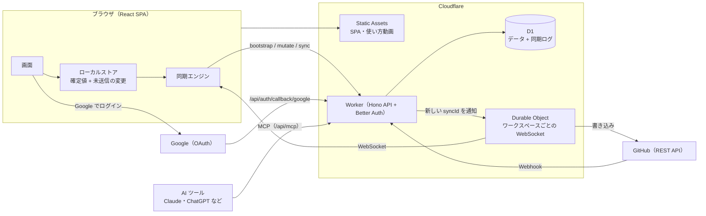

# Sen（線）— Linear の思想を受け継いだ日本語の課題管理アプリ

**速く、静かに、チームの仕事を前へ。**
Sen は [Linear](https://linear.app) の設計思想（待ち時間のない操作・キーボード中心・決まったワークフロー）を受け継いだ、日本語 UI の課題管理アプリです。Cloudflare Workers + D1 + Durable Objects の上で動き、**各画面の使い方動画を AI がヘッドレスブラウザで実際に操作して自動収録する仕組み**を備えています。

---

## 受け継いだ 3 つの原則

| 原則 | Sen での実装 |
| --- | --- |
| **速さ（待ち時間ゼロ）** | 起動時にワークスペース全体を手元に読み込み、画面はすべてローカルのデータから描画。変更は楽観的に即反映し、裏でサーバーへ送信します。次回からは IndexedDB のキャッシュで瞬時に起動し、差分だけを取得。サービスワーカーによりオフラインでも起動でき、オフライン中の変更は接続が戻ると自動で送信されます。 |
| **キーボードで完結** | `⌘K` コマンドパレット、`C` 作成、`J/K` 移動、`S/P/A/L` でプロパティ変更、`X` で複数選択、`G → I` などの移動、`⌘Z` で元に戻す。`?` で一覧表示。 |
| **決まった流れ** | バックログ → 未着手 → 進行中 → レビュー中 → 完了。チーム・プロジェクト・サイクルでリズムを作ります。 |

## 主な機能

- **課題**：チームごとの連番 ID（`ENG-12`）、ステータス・優先度・担当者・ラベル・プロジェクト・サイクル・見積もり・期日・親子関係
- **一覧**：リスト / ボード（ドラッグ＆ドロップ。スマホのリストでは長押ししてから動かす）、グループ分け（ステータス・担当者・優先度・プロジェクト・サイクル・ラベル）、並び順、フィルター、表示項目の切り替え（画面ごとに保存）
- **課題の詳細**：GitHub と同じ Markdown（GFM）のエディタ、サブ課題、変更履歴、コメント（`@` メンション）、購読（[詳しく](docs/guide/02-issues.md#markdown)）
- **課題どうしの関係**：「ブロックされている / ブロックしている」「関連」「重複」。未完了の課題に止められている課題には一覧・ボードで印が付き、重複にした課題は自動で「重複」ステータスへ（`M → B / X / R / M`）
- **受信トレイ**：割り当て・コメント・メンション・ステータス変更の通知を課題ごとにまとめて表示、キーボードで既読 / 削除
- **自分の課題**：担当・作成・購読中
- **プロジェクト**：ステータス・リード・目標日・進捗率・バーンアップチャート・お気に入り。一覧はドラッグで表示順を並び替えられる
- **サイクル**：現在 / 今後 / 過去、スコープと完了の推移グラフ、`Shift+C` で追加
- **検索**：タイトル・説明・ID を即時検索（ひらがな / カタカナ / 全角半角の違いを吸収）
- **リアルタイム同期**：Durable Object（WebSocket Hibernation）が変更を通知し、各クライアントが差分を取得
- **ローカルファースト**：IndexedDB キャッシュによる瞬時の起動、サービスワーカーによるオフライン起動、`⌘Z` で直前の操作を元に戻す
- **アプリとしてインストール（PWA）**：デスクトップやスマートフォンのホーム画面から専用のウィンドウで開けます。新しいバージョンを公開すると「更新」を案内します（[詳しく](docs/guide/12-app.md)）
- **AI 連携（MCP）**：Claude・ChatGPT・Claude Code・Cursor などから、OAuth で URL を入れるだけで接続。課題の作成・更新・検索・コメント・関係づけ。AI の変更には「Claude 経由」のような印（[詳しく](docs/guide/10-ai.md)）
- **AI アシスタント**：画面の中で Sen の使い方を質問できる。説明・画面を開くボタン・使い方動画・聞き返しまでで、課題などのデータは AI に送らない（[詳しく](docs/guide/13-help.md)）
- **進捗**：ワークスペースのメンバーが、プロジェクト（活動）ごとの完了率・直近期限・活動状況と、作業の WBS・タイムラインをアプリの中で見られます（[詳しく](docs/guide/07-progress.md)）
- **GitHub 連携**：タイトル・説明・開閉・コメント（追加のみ）・同じ名前のラベル・登録した担当者を双方向に同期し、プルリクエストを課題に紐づけます（[詳しく](docs/guide/14-github.md)）
- **ログイン**：Google アカウントのみ（[Better Auth](https://www.better-auth.com)）。初めての人はログイン後にワークスペースを作るか、招待されたメールアドレスの招待リンクから参加。複数の Google アカウントでログインして、サイドバー下部のメニューから切り替えられます
- **設定**：プロフィール、テーマ（ライト / ダーク / システム）、最初に開くワークスペース（すべての端末で共通）、メール指定の招待・権限、利用できるドメイン、ラベル、チーム、ワークフロー、サイクル期間
- **使い方動画**：各画面右上の「▶ 使い方」とヘルプ画面から再生。チャプター（ステップ）クリックで頭出し、再生速度切り替え。収録シナリオは操作の結果を確かめながら撮るので、画面が壊れていれば収録が失敗します（`bun run tutorials:check` で古い動画も検出）

## 使い方

使い方は [`docs/guide/`](docs/guide/README.md) にまとめています。

- [はじめに](docs/guide/01-basics.md)
- [課題の作成と編集](docs/guide/02-issues.md)
- [一覧とボード](docs/guide/03-lists.md)
- [受信トレイと自分の課題](docs/guide/04-inbox.md)
- [プロジェクト](docs/guide/05-projects.md)
- [サイクル](docs/guide/06-cycles.md)
- [進捗](docs/guide/07-progress.md)
- [検索・コマンドパレット・キーボード](docs/guide/08-search.md)
- [設定](docs/guide/09-settings.md)
- [AI ツールとの連携](docs/guide/10-ai.md)
- [アプリ・オフライン・同期](docs/guide/12-app.md)
- [使い方動画と AI アシスタント](docs/guide/13-help.md)
- [GitHub 連携](docs/guide/14-github.md)

## 構成



- **同期の仕組み**：すべての変更は `sync_log` に連番で記録されます。クライアントは「最後に受け取った番号」以降だけを取得します。Durable Object は「新しい変更がある」ことだけを通知するので、接続が切れても取りこぼしません。
- **楽観的更新**：画面の状態 =「サーバー確定値」+「未送信の変更」。他人の変更が届くたびに未送信の変更を重ね直すため、衝突しても表示が崩れません。失敗した変更は自動で巻き戻し、トーストで知らせます。
- **ログイン**：Better Auth の Google ログインだけを有効にしています。ログインの情報は `auth_*` テーブル、アプリのプロフィール（表示名・設定）は `users` テーブルが持ち、同じ ID で結び付けます。以前のメール + パスワードのアカウントは、同じメールアドレスの Google アカウントで初めてログインしたときに引き継がれます（ワークスペースや課題はそのまま）。
- **本文の保存**：サーバーは受け取った文字列を書き換えず、そのまま保存します。GitHub と同期したとき、変わっていないのに差分が出ないようにするためです。
- **自動マイグレーション**：初回のリクエストでスキーマを作成します（`wrangler d1 migrations` と同じ管理テーブルを使うので併用できます）。`0009_markdown_bodies` は、保存済みの説明とコメントを、HTML から Markdown へ一度だけ移します。`wrangler d1 migrations apply` は SQL ファイルだけを流すので、この移行は新しい Worker が最初のリクエストで行います。未変換の行の一覧を表で持つので、複数の Worker が同時に動いても、途中で止まっても、二重に変換しません。文字として書かれていた `<` や `1.` などは、記法にならないようにエスケープします。`updated_at` は変えません。移行のあとは、開いていた画面に全体を読み込み直させ、ブラウザのキャッシュ（IndexedDB）も捨てます。
- **定期メンテナンス**：Cron Trigger（毎日 3:17 JST）で 30 日より古い同期ログと期限切れセッションを削除します。古いキャッシュを持つクライアントには全体の読み込み直しを指示します。

## PWA の仕組み

インストールの方法、更新の案内、アプリのショートカット、見た目は [アプリ・オフライン・同期](docs/guide/12-app.md) にあります。

- **事前保存**：ビルド時に `vite.config.ts` が、遅れて読み込む画面（エディタ・ボード）やフォントまで含めたファイルの一覧をサービスワーカー（`src/sw.js` → `sw.js`）に埋め込みます。初めて開いたときにまとめて保存します。使い方動画と API は保存しません。画面の移動はネットワークを優先し、オフラインや 3 秒以上かかる回線では保存しておいた版で起動します。
- **版**：新しいバージョンは裏で保存してから切り替えます。画面の JS と CSS がすでに新しい版のものなら、案内は出さずに保存内容だけ入れ替えます。別のタブで古い画面が開いたままでも動くよう、1 つ前の版の保存内容は残します。
- **ショートカットの URL**：マニフェストの項目は、`/?open=inbox` のような URL で開きます。
- **アイコン**：`public/icons/` の PNG は `bun run icons` で `favicon.svg` と同じ図柄から書き出します（Android の maskable、iOS の `apple-touch-icon` を含む）。

## メンバーの招待と利用できるドメイン

招待の手順、招待中の一覧、期限と参加できるアカウント、1 日に送れる通数、利用できるドメイン、許可外になったときとメンバーを外したときの扱いは、[はじめに](docs/guide/01-basics.md) と [設定](docs/guide/09-settings.md) にあります。

**仕組み**

- リンクのトークンはハッシュだけを保存します。リンクそのものは、作ったときだけ表示します。

## AI 連携（MCP）

Claude・ChatGPT・Claude Code・Cursor などの AI ツールから、Sen の課題を操作できます。手順と、ツールでできることは [AI ツールとの連携](docs/guide/10-ai.md) にあります。

**仕組み**

- 接続先は `POST /api/mcp` です。MCP の Streamable HTTP で、セッションを持たないステートレスなサーバーです。
- 認証は Bearer です。OAuth のアクセストークン（`sen_at_…`）か、ワークスペースごと・個人ごとに発行する個人トークン（`sen_…`）を使います。Cookie は使わないため、CORS は全オリジンに開いています。
- OAuth 2.1 の認可サーバーを Worker に内蔵しています。
  - ディスカバリーは `/.well-known/oauth-protected-resource/api/mcp` と `/.well-known/oauth-authorization-server` です。MCP の 401 応答の `WWW-Authenticate` にある `resource_metadata` からも見つけられます。
  - クライアントの登録は Client ID Metadata Document（CIMD）と DCR に対応します。DCR は `POST /api/oauth/register` です。
  - 認可は `GET /api/oauth/authorize` から同意画面 `/oauth/consent` へ進みます。PKCE の S256 が必須です。
  - トークンは `POST /api/oauth/token` で発行します。アクセストークンは 1 時間有効です。リフレッシュトークンは使うたびに入れ替え、その時点から 90 日有効です。入れ替えの直後 60 秒だけ、再送に備えて 1 つ前のトークンも使えます。それより後に使われたら、接続ごと無効にします。入れ替えで使えなくなったトークンのハッシュも記録し、それが提示されたら接続ごと無効にします。
  - 失効は `POST /api/oauth/revoke` です。接続と、それに属するアクセストークンをまとめて無効にします。
  - `redirect_uri` は https、http のループバック（`localhost`・`127.0.0.1`・`[::1]`）、独自スキームに対応します。実行可能な危険なスキームなどは拒否します。登録した URI と照合し、ループバックではポートを問いません。
- トークン・認可コード・`client_secret` はハッシュだけを保存します。個人トークンの値は発行時だけ表示します。OAuth の保存先は `oauth_clients`、`oauth_requests`、`oauth_codes`、`oauth_grants`、`oauth_access_tokens`、`oauth_refresh_used`（`migrations/0011_oauth.sql`）です。毎日の掃除で期限切れのリクエスト・コード・アクセストークン・接続と、参照されていない古いクライアントを削除します。
- `BETTER_AUTH_URL` が issuer と resource の基準です。公開している URL と同じにしてください。
- 書き込みは画面と同じミューテーションを通るので、検証・履歴・通知・リアルタイム同期がそのまま効きます。
- 説明とコメントは、GitHub 互換の Markdown（GFM）の文字列を、変換せずにそのまま受け渡します。課題のタイトルは 256 文字、説明とコメントは 65,536 文字までです（JS の文字数で数えるので、GitHub より厳しいか、同じです）。

**手元で試すとき**

`bun run dev` で起動し、次を実行します。

```bash
claude mcp add --transport http sen http://localhost:5173/api/mcp
```

Claude Code の `/mcp` で `sen` を選んで認証します。

個人トークンで試すときは、設定の「AI 連携」で発行し、次を実行します。

```bash
claude mcp add --transport http sen http://localhost:5173/api/mcp --header "Authorization: Bearer sen_..."
```

## AI アシスタント

画面の中の動きは [使い方動画と AI アシスタント](docs/guide/13-help.md) にあります。

AI に送るのは、使い方の知識、利用者の質問とそれまでの会話、いま開いている画面の種類だけです。課題・プロジェクト・メンバー・チーム名などのワークスペースのデータは送りません。

モデルは Claude Haiku 5.5 です。利用者ごとに、日本時間の 1 日に質問できる回数を制限します。省略時は 30 回です。`ASSISTANT_DAILY_LIMIT` に正の整数を書くと、その回数になります。

Worker にキーを登録します。

```bash
bunx wrangler secret put ANTHROPIC_API_KEY
```

キーが無いときは AI アシスタントを使いません。ブラウザ内のデモ版でも使えません。

使い方の知識は、`docs/guide/` や画面・コマンド・使い方動画の一覧から、ビルドのときに作られます。

## GitHub 連携

使い方は [GitHub 連携](docs/guide/14-github.md) にあります。

### 設定のしかた

書き込みは個人のアクセストークン（fine-grained を推奨）で行い、リポジトリの Webhook で変更を受け取ります。

1. GitHub で fine-grained の個人アクセストークンを作ります。対象は、連携するリポジトリです。権限は、Issues の読み書き、Pull requests の読み取り、Metadata の読み取りです。Webhook を自動で作るなら、Webhooks の読み書きも付けます。
2. Webhook の secret を決めます。例：`openssl rand -hex 32`
3. Worker に登録します。`GITHUB_WORKSPACE` は、ワークスペースの URL の名前です（例：`ses`）。

   ```bash
   bunx wrangler secret put GITHUB_WORKSPACE
   bunx wrangler secret put GITHUB_TOKEN
   bunx wrangler secret put GITHUB_WEBHOOK_SECRET
   ```

Webhook（Issues、Issue comments、Pull requests。JSON。secret 付き）は自動で作られます。手で作るときは、URL を `https://<Sen のドメイン>/api/github/webhook`、Content type を `application/json`、secret を環境変数 `GITHUB_WEBHOOK_SECRET` の値、イベントを Issues、Issue comments、Pull requests にします。

連携されるのは `GITHUB_WORKSPACE` のワークスペースだけです。それ以外では、設定画面にこの区画は出ません。

手元で試すときは、`.env.local` に同じ名前で書きます。

```bash
GITHUB_WORKSPACE=ses
GITHUB_TOKEN=github_pat_xxxxxxxx
GITHUB_WEBHOOK_SECRET=xxxxxxxx
```

| 変数 | 内容 |
| --- | --- |
| `GITHUB_WORKSPACE` | 連携するワークスペースの URL の名前（例：`ses`） |
| `GITHUB_TOKEN` | 個人のアクセストークン。対象リポジトリの Issues の読み書き、Pull requests の読み取り、Metadata の読み取り。Webhook を自動で作るなら Webhooks の読み書き |
| `GITHUB_WEBHOOK_SECRET` | Webhook の secret |
| `GITHUB_SYNC_DELAY_MS` | Sen の変更を GitHub に送るまでの待ち時間（ミリ秒）。省略時は `3000`。0 は待たずに送ります |
| `GITHUB_API_ORIGIN_FOR_TESTS` | E2E 用。`DEV_TOOLS=1` のときだけ有効で、`https://api.github.com` の代わりにこのオリジンへ送ります。本番では無視します |

### 仕組みと安全のために

- Webhook の `X-Hub-Signature-256` を secret で HMAC-SHA256 し、長さを揃えて比べます。設定が無ければ 503、署名が無い・違うときは 401 です。同じ配送 ID は、もう一度処理しません。
- 受け付けたら、ワークスペースごとの Durable Object に渡してすぐ返します。処理は 1 件ずつです。突き合わせでは、いつも GitHub から最新の Issue を取り直して比べます。
- Sen 側の変更は、`GITHUB_SYNC_DELAY_MS`（省略時 3 秒）待ってから送ります。GitHub 側の出来事は、待たずに順番に処理します。
- 失敗したときは、30 秒、2 分、10 分、1 時間、6 時間後にやり直します。それでも失敗したら、課題の画面に理由が出ます。トークンが無効なときと、利用制限に達したときは、設定画面にも出ます。
- トークンの値と secret は、画面・ログ・同期ログに出しません。設定画面には、トークンのユーザー名と、失敗した理由が出ます。
- GitHub のユーザー名は、本人確認をしません。各自が、自分のプロフィールに登録します。

### 制限

- 連携できるのは、`GITHUB_WORKSPACE` の 1 つのワークスペースだけです。

## はじめかた（ローカル）

必要なもの：[Bun](https://bun.sh)（パッケージ管理）と Node.js 20 以上（Vite・Wrangler の実行に使います）。

```bash
bun install
bun run dev          # http://localhost:5173
```

ログインには Google の OAuth クライアントが必要です（初回だけ）。

1. [Google Cloud Console](https://console.cloud.google.com/apis/credentials) で「OAuth クライアント ID」（種類：ウェブ アプリケーション）を作成し、承認済みのリダイレクト URI に `http://localhost:5173/api/auth/callback/google` を追加します。
2. プロジェクト直下に `.env.local` を作り、クライアント ID とシークレットを書きます（Git には含まれません）。

   ```bash
   GOOGLE_CLIENT_ID=xxxxxxxx.apps.googleusercontent.com
   GOOGLE_CLIENT_SECRET=xxxxxxxx
   ```

3. 「Google でログイン」を押します。初回はワークスペース名を決めると、使い方を学べるサンプル課題入りのワークスペースが作られます。2 つ目以降に作るワークスペースには課題は入りません。
4. チームメンバーや大量の課題を入れて試したいときは、設定 → ワークスペース の「デモデータを投入」を押します（ローカル開発時のみ表示）。

> ローカルの D1 / Durable Object は Miniflare で動きます。データは `.wrangler/state` に保存されます。
> `.env`（Git に含まれる）は `DEV_TOOLS=1` だけを持つローカル専用の設定です。`DEV_TOOLS=1` の環境では、E2E テストや動画収録のために Google を通さない開発用のログイン（`POST /api/auth/dev/sign-in`）も有効になります。使えるアドレスは `@example.com` とそのサブドメインです。本番には含まれません。ローカルでは招待メールは実際には送られず、Wrangler（Miniflare）のログに記録されるだけです。
> `.dev.vars` を作ると Wrangler は `.env` / `.env.local` を読まなくなるので、使う場合は `DEV_TOOLS=1` もそちらに書いてください。

## Cloudflare へのデプロイ

### 手元から（初回）

```bash
bun run cf:setup     # Cloudflare にログイン → D1「sen-db」を作成 → wrangler.jsonc に ID を記入 → スキーマ適用
bun run deploy       # ビルド → 開発用設定の除去 → wrangler deploy
```

`https://sen.<あなたのサブドメイン>.workers.dev` で公開されます。独自ドメインは Cloudflare のダッシュボード（Workers → sen → Settings → Domains & Routes）から設定できます。

続けて、ログインに使う秘密の値を Worker に登録します（初回だけ。デプロイし直しても消えません）。

```bash
openssl rand -base64 32 | bunx wrangler secret put BETTER_AUTH_SECRET   # セッションの署名用（必須）
bunx wrangler secret put GOOGLE_CLIENT_ID
bunx wrangler secret put GOOGLE_CLIENT_SECRET
```

Google Cloud Console の OAuth クライアントには、公開する URL のリダイレクト URI（例：`https://sen.<あなたのサブドメイン>.workers.dev/api/auth/callback/google`、独自ドメインがあればそれも）を追加してください。ログインの戻り先はリクエストの URL から決まります。公開 URL を 1 つに固定したいときは、`BETTER_AUTH_URL`（例：`https://sen.example.com`）も登録します。

招待メールを送るには、送信元のドメインを Cloudflare Email Service の Email Sending に登録します。DNS の設定が必要です。

```bash
bunx wrangler email sending enable <ドメイン>
bunx wrangler secret put INVITE_EMAIL_FROM   # 例: noreply@sen.example.com
```

`wrangler.jsonc` の `send_email` バインディング（名前は `EMAIL`）が、この送信に使われます。`INVITE_EMAIL_FROM` を設定しない場合はメールを送らず、画面に出るリンクをコピーして招待できます。

### GitHub Actions（main へのプッシュで自動デプロイ）

`.github/workflows/deploy.yml` が「型チェック → E2E テスト → デプロイ」を行います。リポジトリの Secrets に次を登録してください。

| Secret | 内容 |
| --- | --- |
| `CLOUDFLARE_API_TOKEN` | 「Edit Cloudflare Workers」テンプレートで作成し、D1 の編集権限を追加したトークン |
| `CLOUDFLARE_ACCOUNT_ID` | Cloudflare のアカウント ID |

ログイン用の `BETTER_AUTH_SECRET` / `GOOGLE_CLIENT_ID` / `GOOGLE_CLIENT_SECRET` は GitHub ではなく、上の `wrangler secret put` で Worker に登録しておきます。

手動実行（Run workflow）で「操作説明動画を AI に再収録させてからデプロイする」にチェックを入れると、デプロイするビルドそのものを AI が操作して動画を撮り直します。再収録ではナレーションに Gemini を使うので、GitHub の Secrets に `GEMINI_API_KEY` を登録してください。

## 使い方動画の自動収録

```bash
bun run tutorials                  # すべての動画を収録
bun run tutorials -- board inbox   # id の一部で絞り込み
bun run tutorials -- --skip-build  # ビルド済みなら省略
bun run tutorials -- --no-narration # ナレーションなしで撮る
```

字幕とタイトルカードは Gemini TTS で読み上げて動画に付けます。`GEMINI_API_KEY` が必要です。キーが無いときは `--no-narration` を付けてください。

**何が起きるか**

1. アプリをビルドし、まっさらな D1 でローカル起動
2. デモ用のチーム・課題・通知を投入（シナリオごとに初期状態へ戻す）
3. ヘッドレス Chromium で、`tutorials/scenarios/*.ts` のシナリオどおりに AI（スクリプト）が操作
   - カーソルの移動・クリックの波紋・押したキー・ステップ番号付きの字幕を画面に重ねて表示
4. Chrome DevTools Protocol のスクリーンキャストで録画し、ffmpeg で H.264 / 1600×1000 の MP4 に変換
5. 各ステップで `t.expect` により操作の結果を確かめ、期待と違えばその動画は書き出さずに失敗させる
6. `public/tutorials/` に動画・サムネイル・`manifest.json`（チャプターの時刻と、収録時の画面のハッシュつき）を出力

`bun run tutorials:check` で、画面やシナリオが変わったのに撮り直していない動画を見つけられます。

アプリは `manifest.json` を読み、各画面の「▶ 使い方」ボタンとヘルプ画面に動画を表示します。画面を変更したら再収録するだけで、説明動画も最新になります。

**シナリオの書き方**（例：`tutorials/scenarios/02-create-issue.ts`）

```ts
export default defineScenario({
  id: "create-issue",
  order: 2,
  screen: "create",            // どの画面の「使い方」に出すか
  title: "課題を作成する",
  summary: "どの画面からでも C キーで課題を作成できます。",
  start: "/team/ENG/active",   // 収録開始時に開いておく画面
  async run(t) {
    await t.caption("C キーを押すと、課題の作成画面が開きます"); // 字幕 + チャプター
    await t.press("c");                                           // 押したキーを大きく表示
    await t.type("ログイン画面にパスワード表示ボタンを追加");      // 人の速さで入力
    await t.click("[data-testid=create-priority]");               // カーソルを滑らかに動かしてクリック
    await t.poster();                                             // 一覧用のサムネイル（字幕なし）
    await t.press("Meta+Enter");
    await t.expect("[data-testid=issue-row]:has-text('パスワード')"); // 結果を確かめる（違えば収録失敗）
    await t.highlight("[data-testid=issue-row]:has-text('パスワード')");
  },
});
```

必要なもの：Node.js 20 以上、Bun、ffmpeg、日本語フォント（Linux では `fonts-noto-cjk`）、`bunx playwright install chromium`。

## テスト

```bash
bun run typecheck
bun run test:e2e     # ビルド → まっさらな DB で起動 → Playwright で実際に操作して検証
```

Google ログイン（Google の画面への遷移・キャンセル時の表示）、初回のワークスペース作成、メール指定の招待と利用できるドメイン、ログアウト、課題の作成・キーボード操作・一括変更と元に戻す、フィルター、ボードのドラッグ＆ドロップ、詳細画面の編集、Markdown のエディタ（記法の入力、表の操作、往復しても失われないこと、開いただけでは保存しないこと）、本文の移行、タイトルと説明・コメントの上限、招待メンバーへのリアルタイム反映と通知、オフライン時の再送、PWA（マニフェストとアイコン、オフラインでの起動、ショートカット、インストールの案内、新しいバージョンへの更新）、AI 連携（OAuth のディスカバリー、DCR・CIMD、同意、PKCE、リフレッシュ、失効、トークンの発行、MCP からの課題の作成・更新・検索・コメント・関係づけ、閲覧のみと認証）、GitHub 連携（Webhook の署名と重複、リポジトリの連携、課題とコメントの双方向の同期、手での紐づけ、PR の紐づけと自動の移動、模擬 GitHub サーバーを使うこと）などを確認します。
Google ログインは、ダミーの認証情報で「Google の画面へ移るところ」と「戻ってきたときの表示」までを確かめます（実際の Google には接続しません）。それ以外のテストは開発用のログインを使います。

## 利用者向けガイド

利用者向けの説明は `docs/guide/` にあります。AI アシスタントの知識は、このガイドと、画面・コマンドの一覧から、ビルド時に作られます。画面や操作を変えたら、同じ変更でガイドも直してください。

- [はじめに](docs/guide/01-basics.md)
- [課題の作成と編集](docs/guide/02-issues.md)
- [一覧とボード](docs/guide/03-lists.md)
- [受信トレイと自分の課題](docs/guide/04-inbox.md)
- [プロジェクト](docs/guide/05-projects.md)
- [サイクル](docs/guide/06-cycles.md)
- [進捗](docs/guide/07-progress.md)
- [検索・コマンドパレット・キーボード](docs/guide/08-search.md)
- [設定](docs/guide/09-settings.md)
- [AI ツールとの連携](docs/guide/10-ai.md)
- [アプリ・オフライン・同期](docs/guide/12-app.md)
- [使い方動画と AI アシスタント](docs/guide/13-help.md)
- [GitHub 連携](docs/guide/14-github.md)

```bash
bun run assistant:check      # ガイドと画面の一覧がずれていないか確認する
bun run assistant:knowledge  # 確認に加えて、作った知識を .tmp/assistant-knowledge.md に書き出す
```

## ディレクトリ構成

```
worker/        Cloudflare Worker（Hono API・Better Auth による Google ログイン・MCP サーバー・ミューテーション・同期・Durable Object・GitHub 連携）
shared/        クライアントとサーバーで共有する型・定数（`progress.ts` は進捗の集計、`markdown.ts` は本文の Markdown の処理）
migrations/    D1 のスキーマ
src/           React アプリ
  store/       ローカルストア・同期エンジン・操作（楽観的更新と元に戻す）
  features/    画面（課題・受信トレイ・プロジェクト・進捗・サイクル・設定・ヘルプ）
  components/  共通部品（ピッカー・エディタ・ポップオーバーなど）
tutorials/     使い方動画の自動収録（シナリオ・オーバーレイ・録画）
tests/e2e/     Playwright の E2E テスト
demo/          バックエンドごとブラウザで動く単一 HTML のデモ版（sql.js）
scripts/       Cloudflare の初期設定・デプロイ前チェック・デモのビルド・PWA のアイコン書き出し・ガイドの図の書き出し
docs/images/   ガイドの図（チーム・プロジェクト・サイクル・課題の関係）
docs/diagrams/ ガイドの図の元データ（HTML。bun run diagrams で docs/images/ に書き出す）
```

## ブラウザだけで動くデモ版

```bash
bun run build:demo   # dist-demo/index.html（単一ファイル）を出力
```

本番と同じ Hono のバックエンドを、SQLite（sql.js）の上でブラウザ内に動かします。データは IndexedDB に保存され、サーバーなしで全機能（リアルタイム同期を除く）を試せます。Google から戻ってくる先のサーバーが無いため、デモ版では Google の代わりにデモ用のアカウントでログインします。
