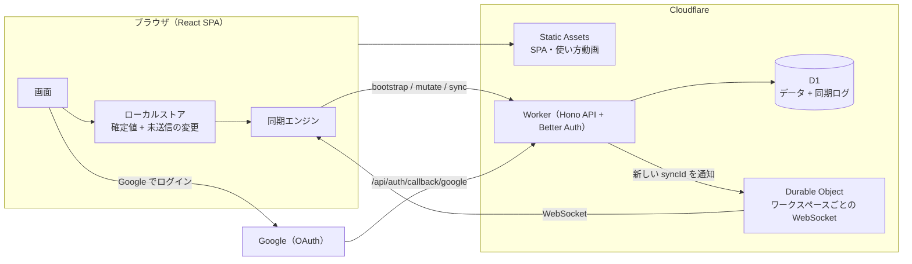

# Sen（線）— Linear の思想を受け継いだ日本語の課題管理アプリ

**速く、静かに、チームの仕事を前へ。**
Sen は [Linear](https://linear.app) の設計思想（待ち時間のない操作・キーボード中心・決まったワークフロー）を受け継いだ、日本語 UI の課題管理アプリです。Cloudflare Workers + D1 + Durable Objects の上で動き、**各画面の使い方動画を AI がヘッドレスブラウザで実際に操作して自動収録する仕組み**を備えています。

---

## 受け継いだ 3 つの原則

| 原則 | Sen での実装 |
| --- | --- |
| **速さ（待ち時間ゼロ）** | 起動時にワークスペース全体を手元に読み込み、画面はすべてローカルのデータから描画。変更は楽観的に即反映し、裏でサーバーへ送信します。次回からは IndexedDB のキャッシュで瞬時に起動し、差分だけを取得。サービスワーカーによりオフラインでも起動でき、オフライン中の変更は接続が戻ると自動で送信されます。 |
| **キーボードで完結** | `⌘K` コマンドパレット、`C` 作成、`J/K` 移動、`S/P/A/L` でプロパティ変更、`X` で複数選択、`G → I` などの移動、`⌘Z` で元に戻す。`?` で一覧表示。 |
| **決まった流れ** | バックログ → 未着手 → 進行中 → レビュー中 → 完了。チーム・プロジェクト・サイクルでリズムを作ります。 |

## 主な機能

- **課題**：チームごとの連番 ID（`ENG-12`）、ステータス・優先度・担当者・ラベル・プロジェクト・サイクル・見積もり・期日・親子関係
- **一覧**：リスト / ボード（ドラッグ＆ドロップ）、グループ分け（ステータス・担当者・優先度・プロジェクト・サイクル・ラベル）、並び順、フィルター、表示項目の切り替え（画面ごとに保存）
- **課題の詳細**：Markdown 記法対応のリッチエディタ、サブ課題、変更履歴、コメント（`@` メンション）、購読
- **課題どうしの関係**：「ブロックされている / ブロックしている」「関連」「重複」。未完了の課題に止められている課題には一覧・ボードで印が付き、重複にした課題は自動で「重複」ステータスへ（`M → B / X / R / M`）
- **受信トレイ**：割り当て・コメント・メンション・ステータス変更の通知を課題ごとにまとめて表示、キーボードで既読 / 削除
- **自分の課題**：担当・作成・購読中
- **プロジェクト**：ステータス・リード・目標日・進捗率・バーンアップチャート・お気に入り
- **サイクル**：現在 / 今後 / 過去、スコープと完了の推移グラフ、`Shift+C` で追加
- **検索**：タイトル・説明・ID を即時検索（ひらがな / カタカナ / 全角半角の違いを吸収）
- **リアルタイム同期**：Durable Object（WebSocket Hibernation）が変更を通知し、各クライアントが差分を取得
- **ローカルファースト**：IndexedDB キャッシュによる瞬時の起動、サービスワーカーによるオフライン起動（PWA としてインストール可能）、`⌘Z` で直前の操作を元に戻す
- **ログイン**：Google アカウントのみ（[Better Auth](https://www.better-auth.com)）。初めての人はログイン後にワークスペースを作るか、招待リンクから参加
- **設定**：プロフィール、テーマ（ライト / ダーク / システム）、メンバー招待リンク・権限、ラベル、チーム、ワークフロー、サイクル期間
- **使い方動画**：各画面右上の「▶ 使い方」とヘルプ画面から再生。チャプター（ステップ）クリックで頭出し、再生速度切り替え。収録シナリオは操作の結果を確かめながら撮るので、画面が壊れていれば収録が失敗します（`bun run tutorials:check` で古い動画も検出）

## 構成



- **同期の仕組み**：すべての変更は `sync_log` に連番で記録されます。クライアントは「最後に受け取った番号」以降だけを取得します。Durable Object は「新しい変更がある」ことだけを通知するので、接続が切れても取りこぼしません。
- **楽観的更新**：画面の状態 =「サーバー確定値」+「未送信の変更」。他人の変更が届くたびに未送信の変更を重ね直すため、衝突しても表示が崩れません。失敗した変更は自動で巻き戻し、トーストで知らせます。
- **ログイン**：Better Auth の Google ログインだけを有効にしています。ログインの情報は `auth_*` テーブル、アプリのプロフィール（表示名・設定）は `users` テーブルが持ち、同じ ID で結び付けます。以前のメール + パスワードのアカウントは、同じメールアドレスの Google アカウントで初めてログインしたときに引き継がれます（ワークスペースや課題はそのまま）。
- **自動マイグレーション**：初回のリクエストでスキーマを作成します（`wrangler d1 migrations` と同じ管理テーブルを使うので併用できます）。
- **定期メンテナンス**：Cron Trigger（毎日 3:17 JST）で 30 日より古い同期ログと期限切れセッションを削除します。古いキャッシュを持つクライアントには全体の読み込み直しを指示します。

## はじめかた（ローカル）

必要なもの：[Bun](https://bun.sh)（パッケージ管理）と Node.js 20 以上（Vite・Wrangler の実行に使います）。

```bash
bun install
bun run dev          # http://localhost:5173
```

ログインには Google の OAuth クライアントが必要です（初回だけ）。

1. [Google Cloud Console](https://console.cloud.google.com/apis/credentials) で「OAuth クライアント ID」（種類：ウェブ アプリケーション）を作成し、承認済みのリダイレクト URI に `http://localhost:5173/api/auth/callback/google` を追加します。
2. プロジェクト直下に `.env.local` を作り、クライアント ID とシークレットを書きます（Git には含まれません）。

   ```bash
   GOOGLE_CLIENT_ID=xxxxxxxx.apps.googleusercontent.com
   GOOGLE_CLIENT_SECRET=xxxxxxxx
   ```

3. 「Google でログイン」を押します。初回はワークスペース名を決めると、使い方を学べるサンプル課題入りのワークスペースが作られます。
4. チームメンバーや大量の課題を入れて試したいときは、設定 → ワークスペース の「デモデータを投入」を押します（ローカル開発時のみ表示）。

> ローカルの D1 / Durable Object は Miniflare で動きます。データは `.wrangler/state` に保存されます。
> `.env`（Git に含まれる）は `DEV_TOOLS=1` だけを持つローカル専用の設定です。`DEV_TOOLS=1` の環境では、E2E テストや動画収録のために Google を通さない開発用のログイン（`POST /api/auth/dev/sign-in`、`@example.com` のアドレス限定）も有効になります。本番には含まれません。
> `.dev.vars` を作ると Wrangler は `.env` / `.env.local` を読まなくなるので、使う場合は `DEV_TOOLS=1` もそちらに書いてください。

## Cloudflare へのデプロイ

### 手元から（初回）

```bash
bun run cf:setup     # Cloudflare にログイン → D1「sen-db」を作成 → wrangler.jsonc に ID を記入 → スキーマ適用
bun run deploy       # ビルド → 開発用設定の除去 → wrangler deploy
```

`https://sen.<あなたのサブドメイン>.workers.dev` で公開されます。独自ドメインは Cloudflare のダッシュボード（Workers → sen → Settings → Domains & Routes）から設定できます。

続けて、ログインに使う秘密の値を Worker に登録します（初回だけ。デプロイし直しても消えません）。

```bash
openssl rand -base64 32 | bunx wrangler secret put BETTER_AUTH_SECRET   # セッションの署名用（必須）
bunx wrangler secret put GOOGLE_CLIENT_ID
bunx wrangler secret put GOOGLE_CLIENT_SECRET
```

Google Cloud Console の OAuth クライアントには、公開する URL のリダイレクト URI（例：`https://sen.<あなたのサブドメイン>.workers.dev/api/auth/callback/google`、独自ドメインがあればそれも）を追加してください。ログインの戻り先はリクエストの URL から決まります。公開 URL を 1 つに固定したいときは、`BETTER_AUTH_URL`（例：`https://sen.example.com`）も登録します。

### GitHub Actions（main へのプッシュで自動デプロイ）

`.github/workflows/deploy.yml` が「型チェック → E2E テスト → デプロイ」を行います。リポジトリの Secrets に次を登録してください。

| Secret | 内容 |
| --- | --- |
| `CLOUDFLARE_API_TOKEN` | 「Edit Cloudflare Workers」テンプレートで作成し、D1 の編集権限を追加したトークン |
| `CLOUDFLARE_ACCOUNT_ID` | Cloudflare のアカウント ID |

ログイン用の `BETTER_AUTH_SECRET` / `GOOGLE_CLIENT_ID` / `GOOGLE_CLIENT_SECRET` は GitHub ではなく、上の `wrangler secret put` で Worker に登録しておきます。

手動実行（Run workflow）で「操作説明動画を AI に再収録させてからデプロイする」にチェックを入れると、デプロイするビルドそのものを AI が操作して動画を撮り直します。

## 使い方動画の自動収録

```bash
bun run tutorials                  # すべての動画を収録
bun run tutorials -- board inbox   # id の一部で絞り込み
bun run tutorials -- --skip-build  # ビルド済みなら省略
```

**何が起きるか**

1. アプリをビルドし、まっさらな D1 でローカル起動
2. デモ用のチーム・課題・通知を投入（シナリオごとに初期状態へ戻す）
3. ヘッドレス Chromium で、`tutorials/scenarios/*.ts` のシナリオどおりに AI（スクリプト）が操作
   - カーソルの移動・クリックの波紋・押したキー・ステップ番号付きの字幕を画面に重ねて表示
4. Chrome DevTools Protocol のスクリーンキャストで録画し、ffmpeg で H.264 / 1600×1000 の MP4 に変換
5. 各ステップで `t.expect` により操作の結果を確かめ、期待と違えばその動画は書き出さずに失敗させる
6. `public/tutorials/` に動画・サムネイル・`manifest.json`（チャプターの時刻と、収録時の画面のハッシュつき）を出力

`bun run tutorials:check` で、画面やシナリオが変わったのに撮り直していない動画を見つけられます。

アプリは `manifest.json` を読み、各画面の「▶ 使い方」ボタンとヘルプ画面に動画を表示します。画面を変更したら再収録するだけで、説明動画も最新になります。

**シナリオの書き方**（例：`tutorials/scenarios/02-create-issue.ts`）

```ts
export default defineScenario({
  id: "create-issue",
  order: 2,
  screen: "create",            // どの画面の「使い方」に出すか
  title: "課題を作成する",
  summary: "どの画面からでも C キーで課題を作成できます。",
  start: "/team/ENG/active",   // 収録開始時に開いておく画面
  async run(t) {
    await t.caption("C キーを押すと、課題の作成画面が開きます"); // 字幕 + チャプター
    await t.press("c");                                           // 押したキーを大きく表示
    await t.type("ログイン画面にパスワード表示ボタンを追加");      // 人の速さで入力
    await t.click("[data-testid=create-priority]");               // カーソルを滑らかに動かしてクリック
    await t.poster();                                             // 一覧用のサムネイル（字幕なし）
    await t.press("Meta+Enter");
    await t.expect("[data-testid=issue-row]:has-text('パスワード')"); // 結果を確かめる（違えば収録失敗）
    await t.highlight("[data-testid=issue-row]:has-text('パスワード')");
  },
});
```

必要なもの：Node.js 20 以上、Bun、ffmpeg、日本語フォント（Linux では `fonts-noto-cjk`）、`bunx playwright install chromium`。

## テスト

```bash
bun run typecheck
bun run test:e2e     # ビルド → まっさらな DB で起動 → Playwright で実際に操作して検証
```

Google ログイン（Google の画面への遷移・キャンセル時の表示）、初回のワークスペース作成、招待リンクからの参加、ログアウト、課題の作成・キーボード操作・一括変更と元に戻す、フィルター、ボードのドラッグ＆ドロップ、詳細画面の編集、招待メンバーへのリアルタイム反映と通知、オフライン時の再送などを確認します。
Google ログインは、ダミーの認証情報で「Google の画面へ移るところ」と「戻ってきたときの表示」までを確かめます（実際の Google には接続しません）。それ以外のテストは開発用のログインを使います。

## キーボードショートカット

| 操作 | キー | 操作 | キー |
| --- | --- | --- | --- |
| コマンドパレット | `⌘K` | 課題を作成 | `C` |
| 検索 | `/` | ショートカット一覧 | `?` |
| 次 / 前の課題 | `J` / `K` | 開く | `Enter` |
| 選択 | `X` | すべて選択 | `⌘A` |
| ステータス | `S` | 優先度 | `P` |
| 担当者 | `A` | 自分に割り当て | `I` |
| ラベル | `L` | プロジェクト | `⇧P` |
| サイクル | `⇧C` | 期日 | `⇧D` |
| リスト / ボード | `⌘B` | 元に戻す | `⌘Z` |
| 受信トレイへ | `G` → `I` | 自分の課題へ | `G` → `M` |
| ID をコピー | `⌘.` | Git ブランチ名をコピー | `⌘⇧.` |
| ブロックされている課題 | `M` → `B` | ブロックしている課題 | `M` → `X` |
| 関連する課題 | `M` → `R` | 重複としてマーク | `M` → `M` |

Windows / Linux では `⌘` の代わりに `Ctrl` を使います。

## ディレクトリ構成

```
worker/        Cloudflare Worker（Hono API・Better Auth による Google ログイン・ミューテーション・同期・Durable Object）
shared/        クライアントとサーバーで共有する型・定数
migrations/    D1 のスキーマ
src/           React アプリ
  store/       ローカルストア・同期エンジン・操作（楽観的更新と元に戻す）
  features/    画面（課題・受信トレイ・プロジェクト・サイクル・設定・ヘルプ）
  components/  共通部品（ピッカー・エディタ・ポップオーバーなど）
tutorials/     使い方動画の自動収録（シナリオ・オーバーレイ・録画）
tests/e2e/     Playwright の E2E テスト
demo/          バックエンドごとブラウザで動く単一 HTML のデモ版（sql.js）
scripts/       Cloudflare の初期設定・デプロイ前チェック・デモのビルド
```

## ブラウザだけで動くデモ版

```bash
bun run build:demo   # dist-demo/index.html（単一ファイル）を出力
```

本番と同じ Hono のバックエンドを、SQLite（sql.js）の上でブラウザ内に動かします。データは IndexedDB に保存され、サーバーなしで全機能（リアルタイム同期を除く）を試せます。Google から戻ってくる先のサーバーが無いため、デモ版では Google の代わりにデモ用のアカウントでログインします。
