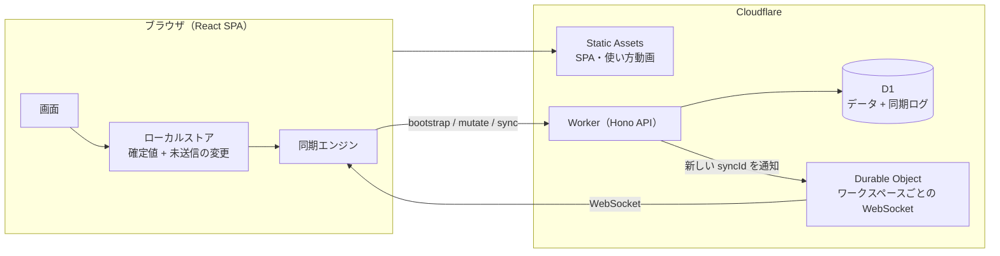

# Sen（線）— Linear の思想を受け継いだ日本語の課題管理アプリ

**速く、静かに、チームの仕事を前へ。**
Sen は [Linear](https://linear.app) の設計思想（待ち時間のない操作・キーボード中心・決まったワークフロー）を受け継いだ、日本語 UI の課題管理アプリです。Cloudflare Workers + D1 + Durable Objects の上で動き、**各画面の使い方動画を AI がヘッドレスブラウザで実際に操作して自動収録する仕組み**を備えています。

---

## 受け継いだ 3 つの原則

| 原則 | Sen での実装 |
| --- | --- |
| **速さ（待ち時間ゼロ）** | 起動時にワークスペース全体を手元に読み込み、画面はすべてローカルのデータから描画。変更は楽観的に即反映し、裏でサーバーへ送信します。次回からは IndexedDB のキャッシュで瞬時に起動し、差分だけを取得。サービスワーカーによりオフラインでも起動でき、オフライン中の変更は接続が戻ると自動で送信されます。 |
| **キーボードで完結** | `⌘K` コマンドパレット、`C` 作成、`J/K` 移動、`S/P/A/L` でプロパティ変更、`X` で複数選択、`G → I` などの移動、`⌘Z` で元に戻す。`?` で一覧表示。 |
| **決まった流れ** | バックログ → 未着手 → 進行中 → レビュー中 → 完了。チーム・プロジェクト・サイクルでリズムを作ります。 |

## 主な機能

- **課題**：チームごとの連番 ID（`ENG-12`）、ステータス・優先度・担当者・ラベル・プロジェクト・サイクル・見積もり・期日・親子関係
- **一覧**：リスト / ボード（ドラッグ＆ドロップ）、グループ分け（ステータス・担当者・優先度・プロジェクト・サイクル・ラベル）、並び順、フィルター、表示項目の切り替え（画面ごとに保存）
- **課題の詳細**：Markdown 記法対応のリッチエディタ、サブ課題、変更履歴、コメント（`@` メンション）、購読
- **受信トレイ**：割り当て・コメント・メンション・ステータス変更の通知、キーボードで既読 / 削除
- **マイイシュー**：担当・作成・購読中
- **プロジェクト**：状態・リード・目標日・進捗率・バーンアップチャート・お気に入り
- **サイクル**：現在 / 今後 / 過去、範囲と完了の推移グラフ、`Shift+C` で追加
- **検索**：タイトル・説明・ID を即時検索（ひらがな / カタカナ / 全角半角の違いを吸収）
- **リアルタイム同期**：Durable Object（WebSocket Hibernation）が変更を通知し、各クライアントが差分を取得
- **ローカルファースト**：IndexedDB キャッシュによる瞬時の起動、サービスワーカーによるオフライン起動（PWA としてインストール可能）、`⌘Z` で直前の操作を元に戻す
- **設定**：プロフィール、テーマ（ライト / ダーク / システム）、メンバー招待リンク・権限、ラベル、チーム、ワークフロー、サイクル期間
- **使い方動画**：各画面右上の「▶ 使い方」とヘルプ画面から再生。チャプター（ステップ）クリックで頭出し、再生速度切り替え

## 構成



- **同期の仕組み**：すべての変更は `sync_log` に連番で記録されます。クライアントは「最後に受け取った番号」以降だけを取得します。Durable Object は「新しい変更がある」ことだけを通知するので、接続が切れても取りこぼしません。
- **楽観的更新**：画面の状態 =「サーバー確定値」+「未送信の変更」。他人の変更が届くたびに未送信の変更を重ね直すため、衝突しても表示が崩れません。失敗した変更は自動で巻き戻し、トーストで知らせます。
- **自動マイグレーション**：初回のリクエストでスキーマを作成します（`wrangler d1 migrations` と同じ管理テーブルを使うので併用できます）。
- **定期メンテナンス**：Cron Trigger（毎日 3:17 JST）で 30 日より古い同期ログと期限切れセッションを削除します。古いキャッシュを持つクライアントには全体の読み込み直しを指示します。

## はじめかた（ローカル）

```bash
npm install
npm run dev          # http://localhost:5173
```

1. 「新規登録」からアカウントとワークスペースを作成します（使い方を学べるサンプル課題が入ります）。
2. チームメンバーや大量の課題を入れて試したいときは、設定 → ワークスペース の「デモデータを投入」を押します（ローカル開発時のみ表示）。

> ローカルの D1 / Durable Object は Miniflare で動きます。データは `.wrangler/state` に保存されます。

## Cloudflare へのデプロイ

### 手元から（初回）

```bash
npm run cf:setup     # Cloudflare にログイン → D1「sen-db」を作成 → wrangler.jsonc に ID を記入 → スキーマ適用
npm run deploy       # ビルド → 開発用設定の除去 → wrangler deploy
```

`https://sen.<あなたのサブドメイン>.workers.dev` で公開されます。独自ドメインは Cloudflare のダッシュボード（Workers → sen → Settings → Domains & Routes）から設定できます。

### GitHub Actions（main へのプッシュで自動デプロイ）

`.github/workflows/deploy.yml` が「型チェック → E2E テスト → デプロイ」を行います。リポジトリの Secrets に次を登録してください。

| Secret | 内容 |
| --- | --- |
| `CLOUDFLARE_API_TOKEN` | 「Edit Cloudflare Workers」テンプレートで作成し、D1 の編集権限を追加したトークン |
| `CLOUDFLARE_ACCOUNT_ID` | Cloudflare のアカウント ID |

手動実行（Run workflow）で「操作説明動画を AI に再収録させてからデプロイする」にチェックを入れると、デプロイするビルドそのものを AI が操作して動画を撮り直します。

## 使い方動画の自動収録

```bash
npm run tutorials                  # すべての動画を収録
npm run tutorials -- board inbox   # id の一部で絞り込み
npm run tutorials -- --skip-build  # ビルド済みなら省略
```

**何が起きるか**

1. アプリをビルドし、まっさらな D1 でローカル起動
2. デモ用のチーム・課題・通知を投入（シナリオごとに初期状態へ戻す）
3. ヘッドレス Chromium で、`tutorials/scenarios/*.ts` のシナリオどおりに AI（スクリプト）が操作
   - カーソルの移動・クリックの波紋・押したキー・ステップ番号付きの字幕を画面に重ねて表示
4. Chrome DevTools Protocol のスクリーンキャストで録画し、ffmpeg で H.264 / 1600×1000 の MP4 に変換
5. `public/tutorials/` に動画・サムネイル・`manifest.json`（チャプターの時刻つき）を出力

アプリは `manifest.json` を読み、各画面の「▶ 使い方」ボタンとヘルプ画面に動画を表示します。画面を変更したら再収録するだけで、説明動画も最新になります。

**シナリオの書き方**（例：`tutorials/scenarios/02-create-issue.ts`）

```ts
export default defineScenario({
  id: "create-issue",
  order: 2,
  screen: "create",            // どの画面の「使い方」に出すか
  title: "課題を作成する",
  summary: "どの画面からでも C キーで課題を作成できます。",
  start: "/team/ENG/active",   // 収録開始時に開いておく画面
  async run(t) {
    await t.caption("C キーを押すと、課題の作成画面が開きます"); // 字幕 + チャプター
    await t.press("c");                                           // 押したキーを大きく表示
    await t.type("ログイン画面にパスワード表示ボタンを追加");      // 人の速さで入力
    await t.click("[data-testid=create-priority]");               // カーソルを滑らかに動かしてクリック
    await t.press("Meta+Enter");
    await t.highlight("[data-testid=issue-row]:has-text('パスワード')");
  },
});
```

必要なもの：Node.js 20 以上、ffmpeg、日本語フォント（Linux では `fonts-noto-cjk`）、`npx playwright install chromium`。

## テスト

```bash
npm run typecheck
npm run test:e2e     # ビルド → まっさらな DB で起動 → Playwright で実際に操作して検証
```

サインアップ / ログイン、課題の作成・キーボード操作・一括変更と元に戻す、フィルター、ボードのドラッグ＆ドロップ、詳細画面の編集、招待メンバーへのリアルタイム反映と通知、オフライン時の再送などを確認します。

## キーボードショートカット

| 操作 | キー | 操作 | キー |
| --- | --- | --- | --- |
| コマンドパレット | `⌘K` | 課題を作成 | `C` |
| 検索 | `/` | ショートカット一覧 | `?` |
| 次 / 前の課題 | `J` / `K` | 開く | `Enter` |
| 選択 | `X` | すべて選択 | `⌘A` |
| ステータス | `S` | 優先度 | `P` |
| 担当者 | `A` | 自分に割り当て | `I` |
| ラベル | `L` | プロジェクト | `⇧P` |
| サイクル | `⇧C` | 期日 | `⇧D` |
| リスト / ボード | `⌘B` | 元に戻す | `⌘Z` |
| 受信トレイへ | `G` → `I` | マイイシューへ | `G` → `M` |
| ID をコピー | `⌘.` | Git ブランチ名をコピー | `⌘⇧.` |

Windows / Linux では `⌘` の代わりに `Ctrl` を使います。

## ディレクトリ構成

```
worker/        Cloudflare Worker（Hono API・認証・ミューテーション・同期・Durable Object）
shared/        クライアントとサーバーで共有する型・定数
migrations/    D1 のスキーマ
src/           React アプリ
  store/       ローカルストア・同期エンジン・操作（楽観的更新と元に戻す）
  features/    画面（課題・受信トレイ・プロジェクト・サイクル・設定・ヘルプ）
  components/  共通部品（ピッカー・エディタ・ポップオーバーなど）
tutorials/     使い方動画の自動収録（シナリオ・オーバーレイ・録画）
tests/e2e/     Playwright の E2E テスト
demo/          バックエンドごとブラウザで動く単一 HTML のデモ版（sql.js）
scripts/       Cloudflare の初期設定・デプロイ前チェック・デモのビルド
```

## ブラウザだけで動くデモ版

```bash
npm run build:demo   # dist-demo/index.html（単一ファイル）を出力
```

本番と同じ Hono のバックエンドを、SQLite（sql.js）の上でブラウザ内に動かします。データは IndexedDB に保存され、サーバーなしで全機能（リアルタイム同期を除く）を試せます。
