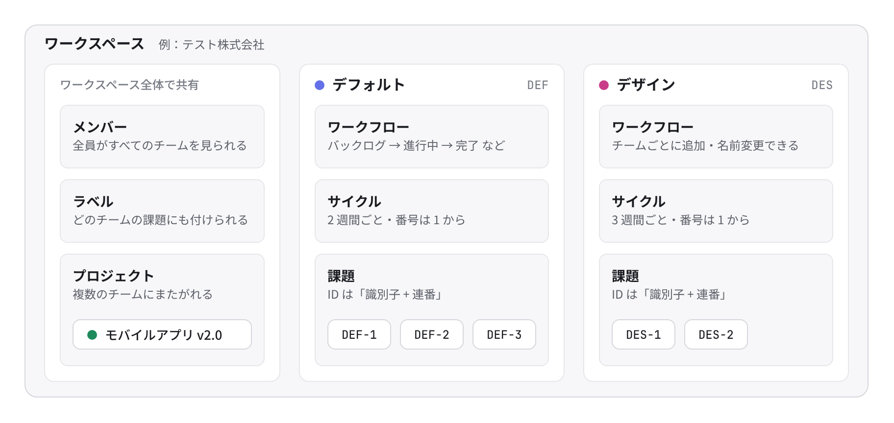
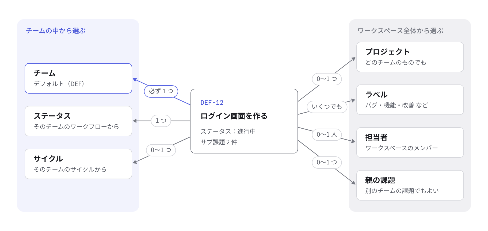
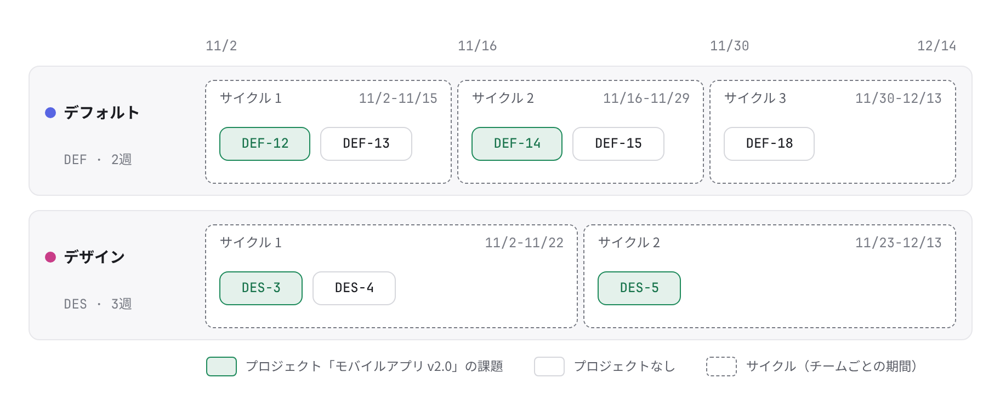

# はじめに

Sen は、チームの仕事を課題にして進めるアプリです。

ログインは Google アカウントだけです。画面のタイトルは「Sen にログイン」です。ボタンは「Google でログイン」です。

初めての人は、ログインするとアカウントが作られます。

## ワークスペース

ワークスペースは、チームと課題の入れ物です。

初めてログインした人は、「ワークスペースを作成」で名前を決めます。ボタンは「はじめる」です。

このとき、使い方を学べるサンプルの課題・プロジェクト・サイクルも入ります。

2 つ目以降のワークスペースには、サンプルは入りません。ボタンは「作成する」です。

左上のワークスペース名を押すと、別のワークスペースへ切り替えられます。

アプリを開いたときと、ログインしたときに開くワークスペースは、設定の「プロフィールと表示」で選べます。

参加しているワークスペースが 2 つ以上のとき、「最初に開くワークスペース」が出ます。

開く順は、選んだワークスペース、この端末で最後に開いたワークスペース、最初に参加したワークスペースです。

選んだワークスペースと、最後に開いたワークスペースは、まだ参加しているときだけ開きます。

選んだワークスペースは、すべての端末で共通です。詳しくは、設定のページです。

「新しいワークスペースを作成」もあります。

招待された人は、自分宛ての招待リンクを開きます。

参加できるのは、招待したメールアドレスの Google アカウントだけです。

招待のリンクは、1 回だけ使えます。7 日たつと期限切れです。

利用できるドメインが設定されているときは、そのドメインと完全に一致するメールアドレスだけが参加できます。サブドメインは含みません。

見出しは、ワークスペースの名前に「に参加」が付いたものです。確認が終わるまでは「招待を確認中…」です。

ログイン前のボタンは「Google でログインして参加」です。

招待したアドレスでログインしているときは、名前のあとに、括弧で囲んだメールアドレスと「としてログイン中です。」が続きます。ボタンは「このアカウントで参加する」です。

「別の Google アカウントで参加」もあります。

別のアカウントでログインしているときは、ログイン中のメールアドレスと「でログイン中です。この招待は」に続き、招待先と「あてです。」が出ます。ボタンは「別の Google アカウントでログインして参加」です。

初めての作成画面の説明には「チームに参加する場合は、招待メールのリンクを開いてください。」とあります。

招待があると、作成画面に「招待されているワークスペース」と出ます。ボタンは「参加する」です。

ログインしている人は、ワークスペース名のメニューからも参加できます。項目は、ワークスペース名のあとに「に参加（招待）」と付きます。

リンクが古いとき、期限が切れたとき、取り消されたときは「招待リンクが無効です」と出ます。

説明は「期限が切れたか、取り消された可能性があります。招待した人に、もう一度招待してもらってください。」です。

## チーム・プロジェクト・サイクル・ラベル

Sen では、課題をチームに入れて管理します。

プロジェクトは、チームをまたいで「何を作るか」で課題を集めます。

サイクルは、チームの中で「いつやるか」を区切ります。

図のチーム名、課題、日付は、説明のための例です。

### 何が何の中にあるか

<picture>
  <source media="(prefers-color-scheme: dark)" srcset="../images/team-structure-dark.png">
  
</picture>

課題は、必ず 1 つのチームに入ります。

チームが持つのは、ワークフロー（ステータスの並び）、サイクル、課題の 3 つです。

メンバー、ラベル、プロジェクトは、ワークスペース全体で共有します。

チームごとのメンバー登録はありません。ワークスペースの人は、すべてのチームを見て操作できます。

課題の ID は、チームの識別子と連番です。例：DEF-1、DES-1。番号は、チームごとに 1 から振られます。

### 1 つの課題から見たつながり

<picture>
  <source media="(prefers-color-scheme: dark)" srcset="../images/issue-links-dark.png">
  
</picture>

課題が必ず持つのは、チームだけです。

ステータスとサイクルは、そのチームのものからしか選べません。

プロジェクト、ラベル、担当者、親の課題は、チームに関係なく選べます。

別のチームへ移すと、ID が振り直されます。例：DEF-12 が、DES-6 のように移った先の次の番号になります。

ステータスは、移った先の同じ種類の先頭になります。

サイクルは外れます。

### プロジェクトはチームをまたぎ、サイクルはチームの中で区切る

<picture>
  <source media="(prefers-color-scheme: dark)" srcset="../images/projects-and-cycles-dark.png">
  
</picture>

緑の課題は、プロジェクト「モバイルアプリ v2.0」の課題です。

DEF と DES の、両方のチームにまたがります。

プロジェクトの画面で、進捗の割合とグラフにまとめて集計されます。

点線の枠は、サイクルです。

期間は、チームごとに 1〜4 週間から選べます。図では、DEF が 2 週間、DES が 3 週間です。

課題が入れるのは、自分のチームのサイクルだけです。

| もの | 表すこと | ポイント |
| --- | --- | --- |
| チーム | 誰が受け持つか | 課題、ワークフロー、サイクルを持ちます。識別子（DEF）が、課題 ID の頭になります |
| プロジェクト | 何を作るか | 複数のチームの課題を集めて、進み具合を自動で集計します。リードや目標日を決められます |
| サイクル | いつやるか | チームごとの、1〜4 週間の区切りです。課題を、今のサイクルや次のサイクルに入れて進めます |
| ラベル | どんな種類か | バグ、機能、改善などです。全チームで共通です。1 つの課題に、いくつでも付けられます |

## 課題 ID

課題の ID は「チームの識別子 + 番号」です。

例：DEF-12。

番号はチームごとに 1 から振られます。

最初のチームは「デフォルト」です。識別子は DEF です。

ラベル「バグ」「機能」「改善」も、最初からあります。

## 決まった流れ

新しいチームには、7 つのステータスが入ります。

バックログ、未着手、進行中、レビュー中、完了、キャンセル、重複です。

種類は 5 つです。バックログ、未着手、進行中、完了、キャンセルです。

レビュー中の種類は、進行中です。

重複の種類は、キャンセルです。

名前は、チームの設定で変えられます。種類は、そのステータスの役割のままです。

普段の流れは、バックログ → 未着手 → 進行中 → レビュー中 → 完了です。

やらない課題はキャンセルにします。

同じ仕事がもうある課題は、重複にします。

## はじめの流れ

1. ワークスペースを作ると、最初のチーム「デフォルト」（識別子は DEF）と、ラベル（バグ、機能、改善）が作られます。名前と識別子は、設定の「チームの設定」から変えられます。初めて作るワークスペースには、使い方を学べるサンプルの課題、プロジェクト、サイクルも入ります。2 つ目以降のワークスペースには、サンプルは入りません。
2. 仕事を受け持つまとまりごとに、チームを追加します。下の「チームを追加する」です。
3. 作りたいものごとに、プロジェクトを作ります。サイドバーの「プロジェクト」から「新しいプロジェクト」を開き、関わるチームを選びます。
4. チームの「サイクル」から「新しいサイクル」を押し、今の期間を作ります。
5. `C` で課題を作ります。`Shift+P` でプロジェクトに入れます。`Shift+C` でサイクルに入れます。

はじめて開くと「Sen へようこそ」と出ます。「使い方動画を見る」か「はじめる」を選びます。

## チームを追加する

1. 左上のワークスペース名のメニュー、または `G` のあと `S` で、設定を開きます。「ワークスペース」の「チーム」を選びます。
2. チーム名（例：デザイン）と、識別子（例：DES）を入力します。識別子は、英大文字で始まる 1〜7 文字の英数字です。課題 ID の頭に付きます。
3. 「チームを作成」を押します。作ったチームは、サイドバーの「チーム」に並びます。

作ったチームには、7 つのステータスが最初から入ります。バックログ、未着手、進行中、レビュー中、完了、キャンセル、重複です。

課題の番号は、1 から始まります。例：DES-1。

管理者でなくても、メンバーなら作れます。

チームの設定では、ステータスの追加と、名前の変更ができます。

サイクルを使うかどうかと、期間（1〜4 週間）も変えられます。

## 画面の入り口

左のサイドバーが、主な画面への入り口です。

上から、受信トレイ、自分の課題、プロジェクト、進捗です。

その下に、チームごとの「課題」「サイクル」「プロジェクト」があります。

チーム名を押すと、その下を畳んだり開いたりできます。サイクルを使わないチームでは、「サイクル」は出ません。

サイドバーの下に「AI に質問」（AI アシスタントが使えるとき）、「使い方動画」、「ショートカット」があります。

左下には、同期の状態が出ます。「同期済み」「同期中…」「オフライン（N件の変更を保持中）」です。
